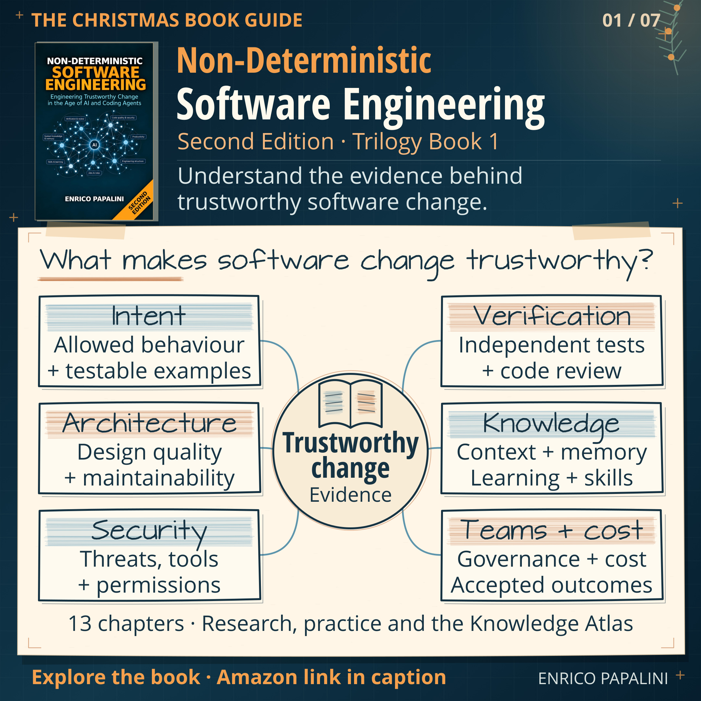
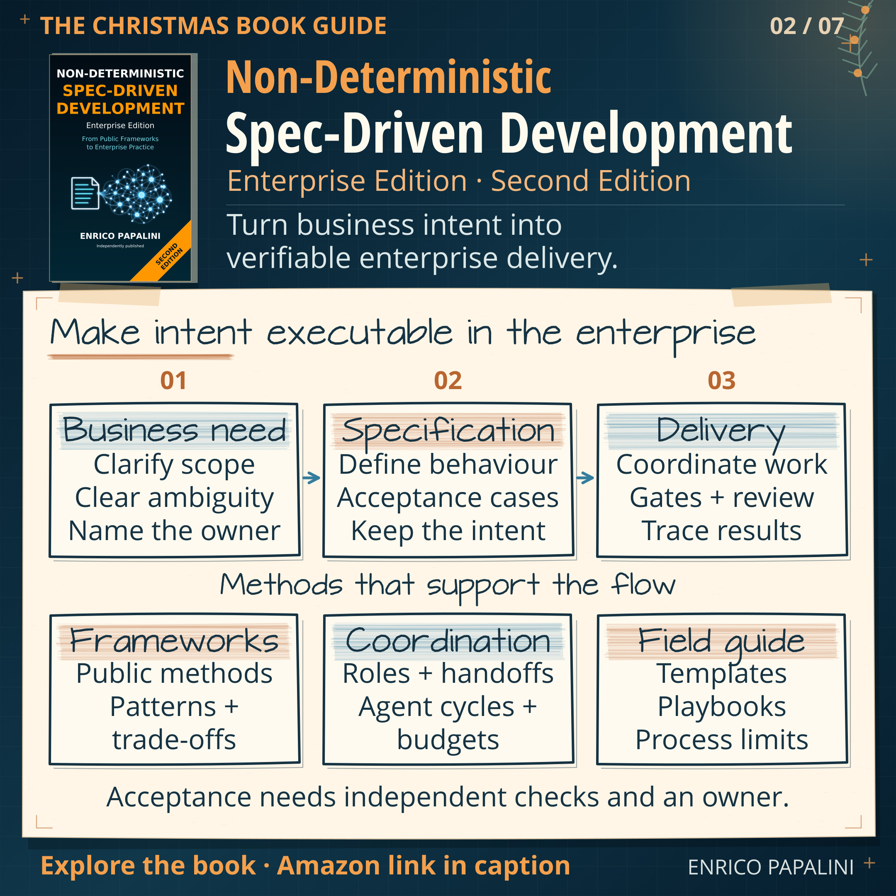
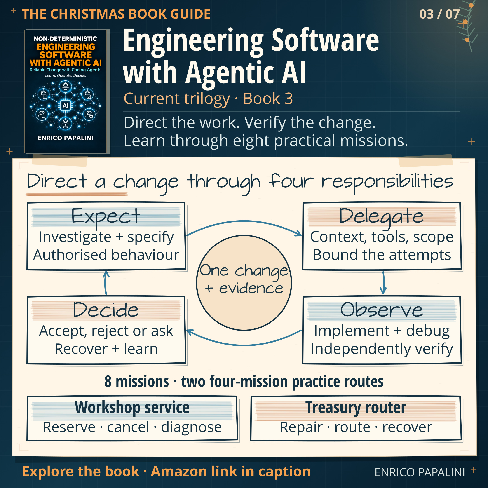
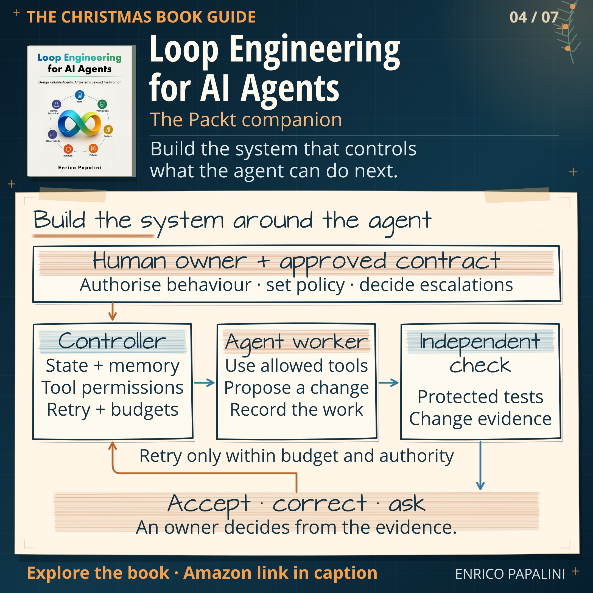
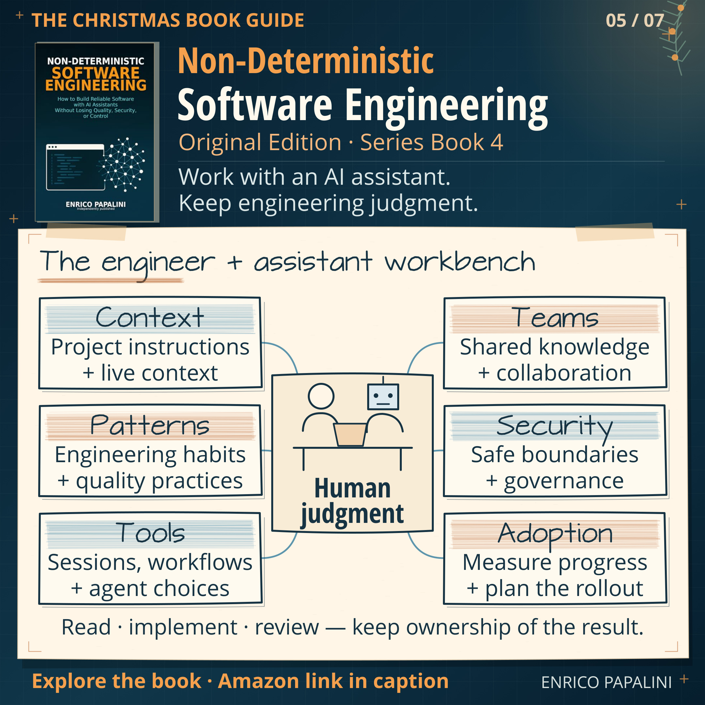
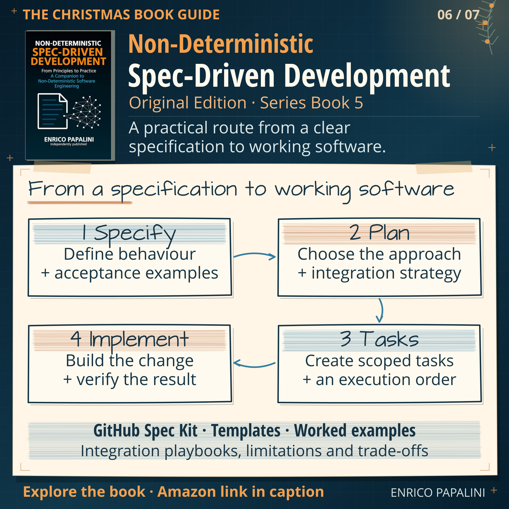
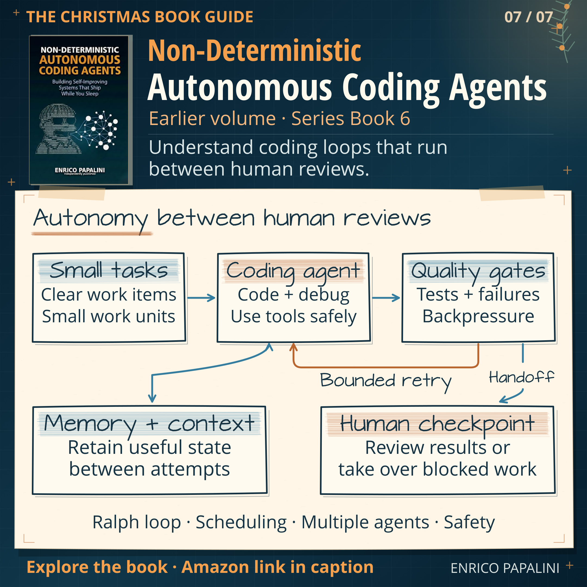

# AI Software Engineering — The Christmas Book Guide

Which book should you read first? A practical map to the foundations, specifications, hands-on missions and agent systems behind reliable AI-assisted development.

By Enrico Papalini

Your coding agent says the job is done. It has changed the files, run the tests and written a confident explanation.

What would make you comfortable accepting its work?

A coding agent is an AI tool that can inspect a project, edit files and run commands or tests as part of an assigned task. That gives it room to do useful work, and gives you decisions to make about its authority and results.

Perhaps you need a clearer requirement. Perhaps the tests miss the failure you actually care about. Perhaps the agent keeps retrying, and you need a way to stop it. Each problem asks for a different kind of engineering knowledge.

I wrote the *Non-Deterministic* books to help you build that knowledge and use it on real decisions. If you are discovering the series today, this article is your map: what each book offers, where to begin, and when to move to another volume.

The name describes a feature of working with AI. Similar requests can produce different implementations, assumptions and mistakes. The goal remains software whose behaviour you can specify, check and take responsibility for. Your development process has to accommodate a contributor whose answers can vary.

The series has evolved from the developer working beside an AI assistant to the engineer directing work that an agent can carry out. As that delegation grows, defining the task, controlling its execution and judging the result become central skills.

## The map: three current books, plus a route into agent systems

The current *Non-Deterministic* trilogy has a natural reading order: **understand the engineering, make the intent precise, then practise conducting a change**.

A separate Packt book, *Loop Engineering for AI Agents*, extends the map into the execution system around the agent. It complements the trilogy; the original three *Non-Deterministic* volumes occupy positions four through six in the series.

As the [companion’s reading guide](https://popoloni.github.io/esa_ai/companion/series/READING_THE_SERIES.html) explains, each of these four books stands on its own. You can follow the broad reading order below, or begin with the question blocking your next piece of work.

![A pen-and-crayon reading map. The current trilogy is: 1, Non-Deterministic Software Engineering, Second Edition, for understanding which practices deserve trust; 2, Non-Deterministic Spec-Driven Development: Enterprise Edition, Second Edition, for specifying what a change must do; 3, Engineering Software with Agentic AI, for directing and judging a change. The separately published Packt book Loop Engineering for AI Agents covers the execution runtime. All four connect to the reader's next engineering question; each stands alone.](assets/reading-map.jpg)

A reading map adapted from the companion’s four-volume guide. The numbered books form the current trilogy. The separate Packt volume develops the agent execution system. Choose an entry point by your question, then follow the next unresolved decision.

The sections below use a simple two-layer reading method. First, the square card introduces the book’s main question and scope. Then the larger pen-and-crayon figure expands the relationships among its practices and topics. These are editorial learning maps, not chapter-by-chapter contents pages; the linked catalogues give the exact chapters.

## 1. Understand what makes an AI-assisted change trustworthy

Start here for the engineering foundations: what must be understood, protected and verified before an AI-assisted change can be accepted. The square card is an editorial reading aid; the larger figure below explains the coverage in greater detail. [View this book on Amazon](https://www.amazon.com/dp/B0HN9J7VZG).

**The question to begin with.** If a coding agent produces a convincing patch, what makes that patch trustworthy?

**How to read the banner.** The diagram places trustworthy change at its centre. Follow the links from intent and architecture through security, independent checks, system knowledge and team responsibility. These are the questions to resolve before speed becomes useful.

**[Non-Deterministic Software Engineering — Second Edition](https://popoloni.github.io/catalogues/volumes/v06.html)** *Engineering Trustworthy Change in the Age of AI and Coding Agents*

Start here if you want a foundation for judging the advice surrounding AI-assisted development.

An assistant produces code quickly. How much useful work did that save? A test passes. How was its expected answer established? An agent remembers something about your system. Is that information still correct, and should it influence the next change?

This book develops the engineering judgment behind those questions. It connects research and practice across software quality, architecture, security, independent verification, review, system knowledge, developer learning, team governance and economics.

The foundation volume connects six groups of engineering concerns around trustworthy change. This editorial coverage map draws on the [second edition’s chapter catalogue](https://popoloni.github.io/catalogues/volumes/v06.html); the groups are reading themes, not a replacement table of contents.

One especially useful idea is the *test oracle*: the basis for deciding what an answer should be. If the implementation and its test inherit the same mistaken assumption, their agreement can be reassuring and unhelpful. Understanding where expected behaviour comes from changes how you review both the code and the evidence.

Read this volume to decide what evidence you need before trusting an AI-assisted change, and to understand why that evidence matters. Then use its [Knowledge Atlas](https://popoloni.github.io/) to follow the research and practitioner sources behind a topic you want to investigate.

**Best starting point for:** developers building their foundations, reviewers, architects and engineering leaders evaluating AI adoption.

[Buy Non-Deterministic Software Engineering, Second Edition, on Amazon.](https://www.amazon.com/dp/B0HN9J7VZG)

## 2. Give your team a specification it can implement and check

Start here for executable intent: a shared requirement, explicit acceptance examples, coordinated work and accountable gates. The square card is an editorial reading aid; the larger figure below explains the coverage in greater detail. [View this book on Amazon](https://www.amazon.com/dp/B0GZZDFMYF).

**The question to begin with.** When a team asks an agent to build a feature, how do you ensure everyone means the same thing?

**How to read the banner.** Read the upper route from business need to specification to coordinated delivery. The supporting boxes underneath stand for framework choices, handoffs and operating guidance. The point is to make ambiguity and acceptance criteria visible before the work begins.

**[Non-Deterministic Spec-Driven Development: Enterprise Edition — Second Edition](https://popoloni.github.io/catalogues/volumes/v03.html)** *From Public Frameworks to Enterprise Practice*

Start here when your team can generate code faster than it can agree on what the code should do.

Consider a request such as “Let customers cancel an order.” When does cancellation become unavailable? What happens if the customer repeats the request? Which existing behaviours must survive? Who has authority to settle the ambiguous cases?

Those questions are the beginning of a specification. A useful specification makes intent durable, resolves consequential ambiguity and gives implementation and verification a shared reference.

This volume examines public specification-driven development frameworks and develops enterprise practices around clarification, consistency checks, traceability, delivery gates, coordinated work and evidence. A gate is a checkpoint used to decide whether work may advance. The book’s patterns, playbooks and templates help you carry a requirement through a delivery process that several people and agents can follow.

The Enterprise Edition connects business intent, explicit specifications and delivery evidence with the frameworks, roles and working references that support them. Coverage adapted from its [chapter catalogue](https://popoloni.github.io/catalogues/volumes/v03.html).

It also asks how much process a task deserves. Chapter 16 examines when a specification process costs more than the failures it prevents. That question matters when you are choosing a lightweight practice for one change or a broader method for a team.

Use this book when the next obstacle is agreeing on the work and preserving that agreement through implementation.

**Best starting point for:** tech leads, architects and teams adopting specification-driven development or improving an existing delivery process.

[Buy Non-Deterministic Spec-Driven Development: Enterprise Edition on Amazon.](https://www.amazon.com/dp/B0GZZDFMYF)

## 3. Practise directing an agent and deciding whether to accept its work

Start here for hands-on agentic engineering: Expect, Delegate, Observe and Decide, then choose the workshop or Treasury practice path. The square card is an editorial reading aid; the larger figure below explains the coverage in greater detail. [View this book on Amazon](https://www.amazon.com/dp/B0HSPH86CG).

**The question to begin with.** Your agent says the work is finished. Which decision is still yours?

**How to read the banner.** Follow the circle: Expect establishes authorised behaviour; Delegate bounds the agent’s task; Observe gathers evidence; Decide accepts, corrects or refers the result. The two routes at the bottom turn these responsibilities into eight linked missions.

**[Engineering Software with Agentic AI](https://popoloni.github.io/catalogues/volumes/v07.html)** *Reliable Change with Coding Agents*

Start here if you have a coding task in front of you and want to learn how to conduct it with an agent.

This is the practical route through the current trilogy. Twelve chapters and eight missions develop the decisions involved in taking an AI-assisted change from its initial request through checking, integration, release and recovery.

The recurring workflow is **Expect, Delegate, Observe, Decide**:

- **Expect:** establish the authorised behaviour and what would count as success.

- **Delegate:** give the agent a bounded task with clear scope and limits.

- **Observe:** inspect the actual result and independently check the exact version of the proposed change.

- **Decide:** record whether the evidence supports acceptance, requires correction or calls for an owner’s decision.

Expect, Delegate, Observe, Decide connects the practical book’s engineering responsibilities. The workshop and Treasury routes each contain four missions. This coverage map summarises the [twelve chapters and eight missions](https://popoloni.github.io/catalogues/volumes/v07.html); its thematic grouping is not a chapter sequence.

The practical companion includes work orders, recorded sessions and independent checks. The proposed version under review is called the *candidate*. You can study a complete repair in Chapter 1, then choose a practice route: develop a workshop booking service, or work on an existing Treasury routing application.

The two routes let you explore different responsibilities. Building a new capability requires a precise promise about behaviour. Changing an existing system also requires attention to the decisions, data and contracts already in place.

Read with a notebook beside you. Before looking at the next step in a recorded session, write down what you would ask the agent to do, what you would check and what would make you stop. Then compare your decision with the record.

**Best starting point for:** engineers who want to move from reading about agents to practising accountable delegation.

[Buy Engineering Software with Agentic AI on Amazon.](https://www.amazon.com/dp/B0HSPH86CG)

## The companion route: build the system that controls the agent

Start here for the execution harness: persistent state, bounded attempts, a separate checker and an accountable human owner. The square card is an editorial reading aid; the larger figure below explains the coverage in greater detail. [View this book on Amazon](https://www.amazon.com/dp/1808766415).

**The question to begin with.** What prevents a persistent coding agent from retrying forever or acting outside its authority?

**How to read the banner.** The human owner and approved contract sit above the execution path. The controller manages state, tools and attempts; the worker proposes changes; an independent check tests what happened. Budget and escalation rules decide whether another attempt is justified.

**[Loop Engineering for AI Agents](https://popoloni.github.io/catalogues/volumes/v05.html)** *Design Reliable Agentic AI Systems Beyond the Prompt*

Suppose you can already conduct one useful agent-assisted change. Now you want a system that can manage repeated attempts, preserve state, enforce a budget and request help when progress stops.

That is the problem addressed by this separate Packt volume.

The *execution harness* is the software around the model that controls how work runs. It determines which tools are available, what state survives between attempts, what counts as progress, how retries work and when execution must end.

*Loop Engineering for AI Agents* develops those controls through controllers, persistent state, resource limits, stopping rules and practical runtime recipes. It also addresses the separation between the worker proposing a result and the checking process used to evaluate it.

The Packt companion develops the execution system around the agent: a controller, worker, independent checking, retained state and human authority. Its [coverage](https://popoloni.github.io/catalogues/volumes/v05.html) also includes organisational responsibilities, economics and choosing an adequate loop.

The relationship with *Engineering Software with Agentic AI* is especially useful. One teaches you to conduct and judge a software change. The other develops the machinery that supports repeated, controlled execution. Read them together when you are turning an individual workflow into a reusable agent system.

**Best starting point for:** platform engineers, senior developers and architects building agent infrastructure or autonomous workflows.

[Buy Loop Engineering for AI Agents on Amazon.](https://www.amazon.com/dp/1808766415)

## See the four books working on one change

Return to our order-cancellation example. This is an illustration for this article, separate from the books’ teaching applications.

The business owner agrees that an unshipped order may be cancelled and that repeating an accepted cancellation must preserve the recorded outcome.

*Non-Deterministic Software Engineering* helps you examine the authority behind that rule, the risks of changing the system and the independence of the checks you will use.

*Non-Deterministic Spec-Driven Development: Enterprise Edition* helps you turn the agreement into explicit cases, connect them to implementation work and keep the acceptance criteria visible through the delivery process.

*Engineering Software with Agentic AI* helps you prepare the work order, delegate a bounded change, inspect the candidate and make the acceptance decision.

*Loop Engineering for AI Agents* helps you design the surrounding controller: permitted tools, retained state, retry limits, budgets and escalation when the task cannot proceed safely within its authority.

The books meet at the same change, but each develops a different responsibility. You move between them as the questions become more specific.

## Choose your reading route

### If you want a broad foundation

Follow the current trilogy in order: *Non-Deterministic Software Engineering*, Second Edition; *Non-Deterministic Spec-Driven Development: Enterprise Edition*, Second Edition; then *Engineering Software with Agentic AI*. You move from engineering principles to explicit intent to practical execution and acceptance. Add *Loop Engineering for AI Agents* when you need to design the runtime.

### If you want to work with an agent now

Begin with *Engineering Software with Agentic AI*, Chapter 1, and a companion mission. When a decision exposes a gap, follow it: unclear requirements lead to the specification book; uncertainty about evidence leads to the software engineering foundation; execution controls lead to the loop book.

### If you are improving a team’s delivery process

Begin with *Non-Deterministic Spec-Driven Development: Enterprise Edition*. Pair its specification and gate practices with the candidate checks in *Engineering Software with Agentic AI*. Use *Non-Deterministic Software Engineering* to examine governance, capability development and the economics of the process you introduce.

### If you are building an agent platform

Begin with *Loop Engineering for AI Agents*. Then use *Engineering Software with Agentic AI* to connect runtime controls to the actual work being delegated and the evidence required to accept it. Return to the foundation volume for security, independent checking and review.

### If you lead a team and need to judge adoption

Start with the governance, learning and economics discussions in *Non-Deterministic Software Engineering*. Pair them with Chapter 12 of *Engineering Software with Agentic AI*, which examines learning and the whole cost of adoption. Use Chapter 16 of the specification book to question how much process your situation warrants.

## Where the original three volumes fit

The earlier books remain useful for particular interests and for understanding how the series developed. They are optional branches from the current reading map. The three cards below show the earlier approaches in context: AI collaboration, specification-first workflows, and autonomous coding between human reviews. They provide useful history and focused practical material without replacing the current trilogy.

### 4. Non-Deterministic Software Engineering — original edition

The original workbench: a human developer collaborating with an AI assistant while retaining responsibility for the code and its effects. The square card is an editorial reading aid; the larger figure below explains the coverage in greater detail. [View this book on Amazon](https://www.amazon.com/dp/B0G7LPJBTH).

**The question to begin with.** How can an engineer work productively with an AI assistant without handing over professional judgment?

**How to read the banner.** The engineer and assistant share a workbench. Around them are the practical supports: project context, reusable patterns, tool choices, team collaboration, security and adoption. This is the assistant-centred starting point from which the later books evolved.

The starting point of the series, focused on working with AI assistants while retaining quality, security and control. Choose it for the earlier perspective on everyday collaboration, understanding code and professional development workflows.

The original volume puts the engineer and AI assistant inside a broader professional workflow: context, patterns, quality, teamwork, security and adoption. Coverage adapted from the [original edition’s chapter catalogue](https://popoloni.github.io/catalogues/volumes/v01.html).

[Buy the original edition on Amazon.](https://www.amazon.com/dp/B0G7LPJBTH)

### 5. Non-Deterministic Spec-Driven Development — original edition

The original specification-first workflow: specify, plan, break down tasks and implement with concrete tools and examples. The square card is an editorial reading aid; the larger figure below explains the coverage in greater detail. [View this book on Amazon](https://www.amazon.com/dp/B0GHFBNC5Z).

**The question to begin with.** How do you turn a specification into tasks that can actually be implemented?

**How to read the banner.** The four numbered boxes follow the original practical sequence: specify, plan, divide into tasks and implement. The supporting tools, templates and playbooks make the steps repeatable. The focus here is the hands-on Spec Kit-centred workflow.

The original practical companion, with a stronger focus on GitHub Spec Kit and moving from specification through planning and tasks into implementation. Choose it when that specific workflow is your interest.

The original specification companion follows a practical route from specification to implementation, supported by a toolkit, templates, examples and playbooks. Coverage adapted from its [chapter catalogue](https://popoloni.github.io/catalogues/volumes/v02.html) and the series guide.

[Buy the original edition on Amazon.](https://www.amazon.com/dp/B0GHFBNC5Z)

### 6. Non-Deterministic Autonomous Coding Agents

The early autonomous-agent pattern: small tasks, guarded iterations, retained context, quality gates and a human checkpoint. The square card is an editorial reading aid; the larger figure below explains the coverage in greater detail. [View this book on Amazon](https://www.amazon.com/dp/B0GMCFLH2C).

**The question to begin with.** What does an autonomous coding loop need between two human review points?

**How to read the banner.** The work is decomposed into small tasks; a worker codes and debugs; quality gates challenge the result. The lower path carries useful memory between attempts and hands blocked or risky work back to a person. Autonomy remains bounded.

The earlier exploration of agents carrying coding tasks between human reviews, including failed tests, repeated attempts and the point at which work should return to a person. Choose it to explore that stage in the series’ development.

The autonomous-agents volume covers repeated coding work, task decomposition, memory, quality gates, scheduling and safety. The loop remains connected to human review. Coverage adapted from the [book’s chapter catalogue](https://popoloni.github.io/catalogues/volumes/v04.html).

[Buy Non-Deterministic Autonomous Coding Agents on Amazon.](https://www.amazon.com/dp/B0GMCFLH2C)

For a new reader looking for the current general treatment, my recommended entry points are the three books in the new trilogy.

## How to get more from whichever book you choose

Bring a small change from your own work to your reading: a bug, a feature or a maintenance task. Write down the behaviour you want, the evidence you would trust and the decisions that still need an owner. Each chapter can then help you improve something concrete.

As you practise, distinguish what the agent has stored from what you can now explain or do yourself. An improved memory record and a learned engineering skill are different outcomes.

Keep three distinctions clear as you move between books. The authorised requirement defines the behaviour. A work order organises delegation and acceptance. Runtime controls enforce what the agent can actually do. Writing a restriction into a document still leaves the enforcement work to be done.

Likewise, a framework gate passing or an agent reporting success is one observation in a larger acceptance decision. Keep the independent checks and the accountable owner’s judgment visible.

Use the companion that matches your edition, especially for executable examples and installation recipes. The books’ teaching applications have their own contracts; carry the rule and its expected answers together when you study an example.

You can explore the [public reading guide](https://popoloni.github.io/esa_ai/companion/series/READING_THE_SERIES.html), follow sources through the [Knowledge Atlas](https://popoloni.github.io/), and inspect the [Engineering Software with Agentic AI practical companion](https://popoloni.github.io/esa_ai/) as you choose your route.

## Choose the question. Choose the book. Try a change.

If you are new to the field and want the broadest starting point, [begin with Non-Deterministic Software Engineering, Second Edition](https://www.amazon.com/dp/B0HN9J7VZG).

If you want a practical assignment to work through now, [begin with Engineering Software with Agentic AI](https://www.amazon.com/dp/B0HSPH86CG) and its first complete repair.

If your biggest obstacle is turning business intent into clear, traceable work, [choose Non-Deterministic Spec-Driven Development: Enterprise Edition](https://www.amazon.com/dp/B0GZZDFMYF). If you are building the system that runs the agent, [choose Loop Engineering for AI Agents](https://www.amazon.com/dp/1808766415).

You can also [browse the Non-Deterministic series on Amazon](https://www.amazon.com/dp/B0GHCXPBRM).

Open the book with one real engineering question in mind. Work through a decision, try the relevant practice and keep the evidence. When the next question appears, you will know where to turn.
