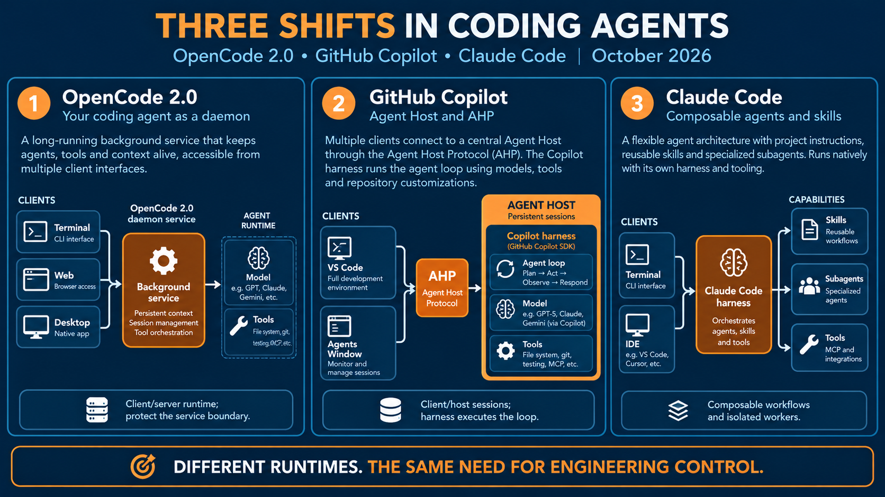
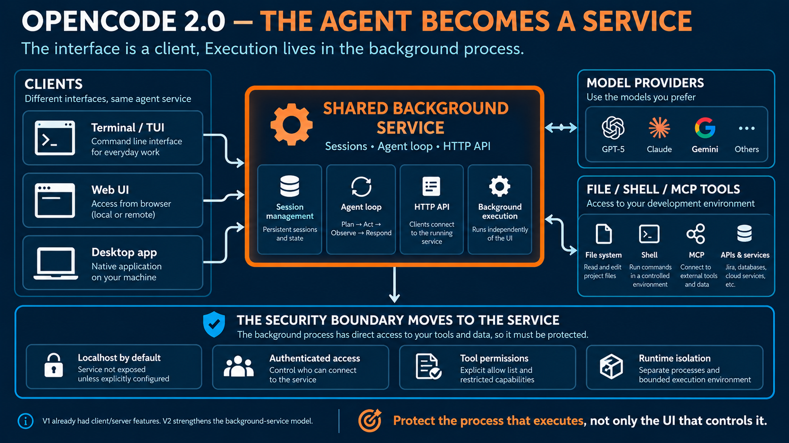
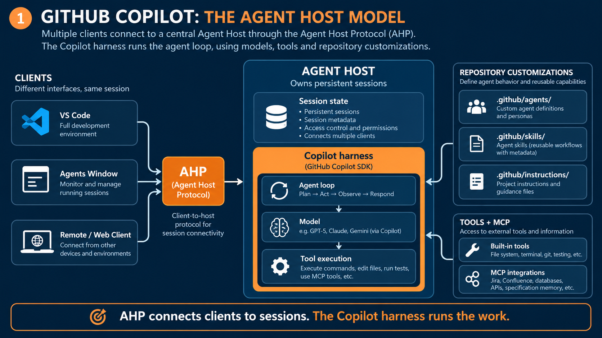
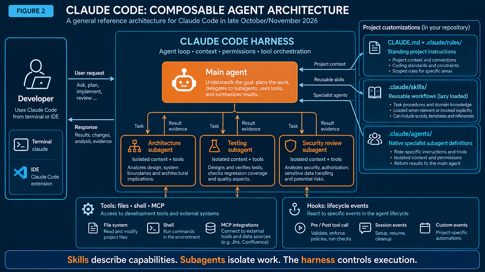
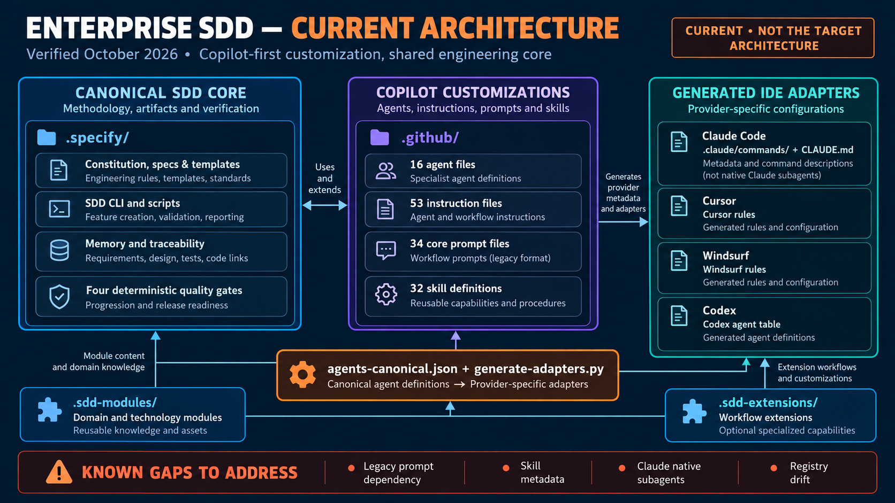
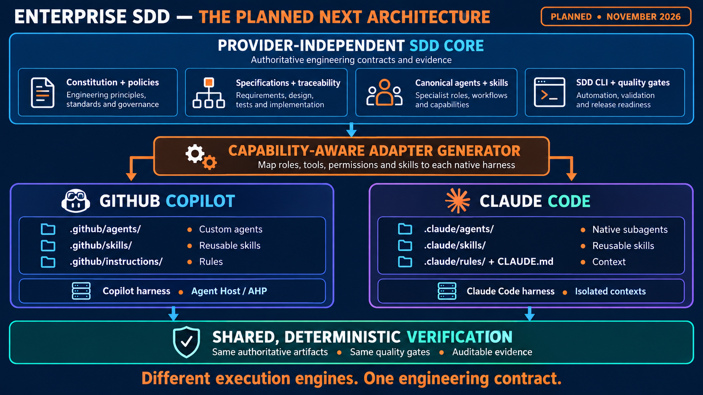
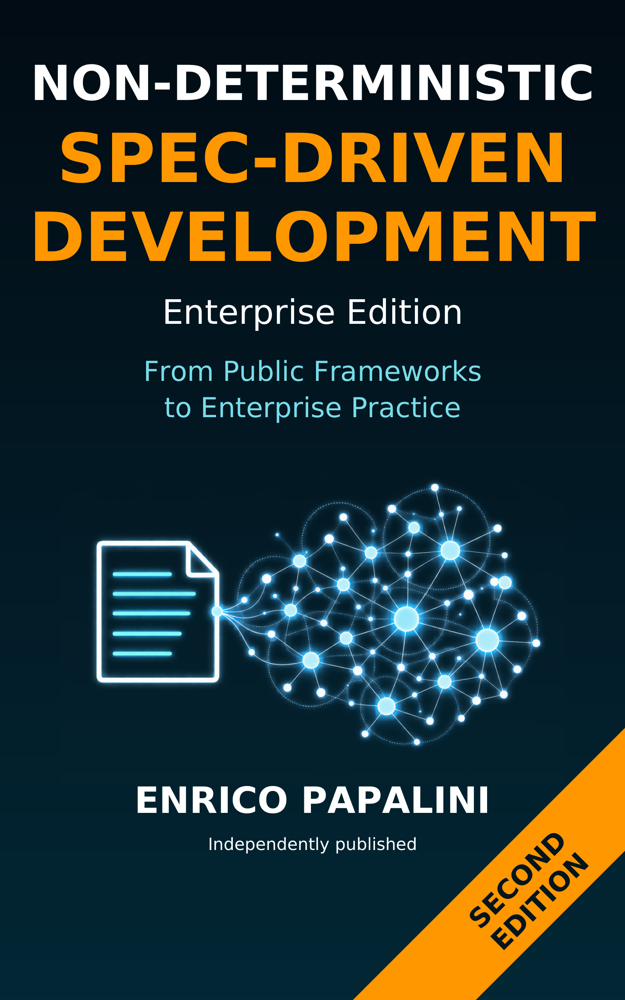

# Coding Agents Are Becoming Infrastructure—or Vendor Lock-In? OpenCode 2.0, GitHub Copilot, Claude Code, and the Next Enterprise SDD

*As November 2026 approaches, coding agents are changing in ways that go far beyond model benchmarks. Three different architectures show why the next generation of software engineering frameworks must separate execution from engineering authority—and why “modern harness” may be both an important abstraction and a new form of vendor lock-in.*

For a while, the most common question about AI-assisted development was simple: **Which model writes better code?**

It is still a relevant question. But increasingly, I find myself asking a different set of questions. Where does the agent actually run? What happens when I close the terminal or the editor? Who decides which tools it can use? How are specialist agents coordinated? And what evidence remains when the conversation is over?

There is now another question that deserves equal attention:

**Does the harness make agents more portable, or does it make users more dependent on the vendor that owns the harness?**

Three developments in 2026 help explain both sides of that tension.

In October, [Najam Us Saqib’s article *OpenCode 2.0 Turned Your Coding Agent Into a Daemon*](https://medium.com/towards-artificial-intelligence/opencode-2-0-turned-your-coding-agent-into-a-daemon-4663135862c4) drew attention to OpenCode’s move toward a shared background service. In August, Microsoft introduced the [Agent Host and Agent Host Protocol (AHP)](https://code.visualstudio.com/blogs/2026/08/26/agent-host-architecture) for sessions that can be accessed from multiple clients. Meanwhile, [Claude Code](https://code.claude.com/docs/en/features-overview) has developed a rich model for combining project instructions, reusable skills, isolated subagents, MCP tools, and lifecycle hooks.

These are **three different architectural choices**, not three names for the same feature. Taken together, they indicate that the coding assistant is turning into a software execution environment in its own right.

They also expose a strategic risk. The more value a harness provides through proprietary session formats, skill metadata, tool APIs, permission models, telemetry, and workflow conventions, the more expensive it can become to leave.

*Figure 1. Three complementary shifts in coding-agent architecture. OpenCode emphasizes the service boundary; Copilot separates session hosting from clients; Claude Code emphasizes reusable capabilities and specialist execution contexts.*

That matters to [**Enterprise SDD**](https://github.com/popoloni/enterprise-sdd), the open-source Spec-Driven Development framework I have been evolving to connect requirements, architecture, implementation, testing, and evidence. Beginning in November 2026, I plan to modernize its GitHub Copilot and Claude Code integrations around these native harness models.

But the migration should not be understood as unconditional adoption. The goal is not to replace one form of lock-in with another. The goal is to use native harness capabilities while keeping the engineering contract, project state, and acceptance criteria portable.

To understand the migration, it helps to unpack what has changed—and where the portability claims become less convincing.

## 1. OpenCode 2.0: the interface is no longer the execution boundary

Imagine that you open a terminal, start a coding assistant, ask it to examine a repository, and then close the terminal. In the traditional mental model, the terminal session and the assistant’s execution environment are nearly the same thing.

OpenCode 2.0 makes that mental model less useful.

Its current architecture includes a **shared background service** to which interfaces such as the terminal UI, web interface, and desktop app can connect. The service owns session management and exposes an API. There is also a standalone server mode for dedicated local or remote setups. According to the [OpenCode v2 documentation](https://opencode.ai/v2/docs/cli/web/), the background service can be managed with commands such as `opencode service start` and `opencode service status`; `opencode serve` runs a foreground instance instead.

One nuance matters: **OpenCode did not invent client/server agents in version 2.** OpenCode v1 already had client/server capabilities. The v2 design makes the shared-service operating model much more central to everyday use, while changing aspects of the server API and integration contracts. The [official v1-to-v2 migration guidance](https://dev.opencode.ai/v2/docs/migrate-v1/) makes this distinction clear.

*Figure 2. In a service-oriented agent setup, the process with access to files, shell commands, APIs, and credentials is the security boundary that matters. Protecting only the client UI is insufficient.*

This separation improves continuity and supports multiple clients, but it also changes the security discussion.

If the agent’s file-system access, tool execution, and credentials belong to a separate process, sandboxing only the terminal interface does not necessarily constrain that process. Isolation, authorization, network exposure, and tool policy have to be applied **where execution occurs**.

That is not an assertion that OpenCode is insecure by default. Its v2 documentation describes local binding and authenticated access, while remote pairing requires deliberate configuration. The lesson is architectural: the security boundary follows the executing service, not the window used to control it.

An article about a daemonized coding agent is therefore also an article about enterprise governance. Who owns the process? Under which OS identity does it run? Which repository and external systems can it reach? How is a denied operation enforced regardless of which client requests it?

The same questions are beginning to matter across agent systems.

OpenCode also illustrates the first portability problem. A service API can make clients more interchangeable, but only if the API is stable, documented, and sufficiently expressive. If clients depend on undocumented session state, proprietary event formats, vendor-specific permissions, or a particular tool registry, the service boundary may simply move the lock-in from the user interface to the protocol.

A client/server architecture is therefore not automatically an open architecture.

## 2. First distinguish the model, the agent, the harness, and the host

Before going further, a little terminology prevents a surprising amount of confusion.

A **model** supplies the reasoning capability. An **agent** uses that capability within a task-oriented loop, with instructions and tools. A **harness** manages the loop: preparing context, invoking the model, executing authorized tool requests, observing results, and continuing or stopping. A **host** manages the lifecycle and connectivity of agent sessions; the precise division of responsibilities depends on the product.

One more layer sits outside this runtime architecture: an **engineering framework**. It defines what is expected, what is allowed, what evidence must be produced, and what counts as satisfactory completion.

Those are not interchangeable responsibilities.

A powerful model does not automatically imply safe tool permissions. A persistent session does not establish that its context is fresh. A specialist subagent does not make its findings independently verified. And a successful agent loop does not prove that the implementation meets the original business requirement.

This is why the changes in Copilot and Claude Code are so relevant to Enterprise SDD.

It is also why the word **harness** deserves skepticism.

The term sounds neutral, like a standard layer that sits between a model and a set of tools. In practice, a modern harness often bundles several proprietary decisions:

- how context is assembled;
- which files are automatically loaded;
- how tools are named and authorized;
- how skills are discovered;
- how subagents are created;
- how sessions are serialized;
- how approvals are represented;
- how telemetry and policy enforcement work;
- which models and providers are supported;
- and which client surfaces can reconnect to a session.

Some of these capabilities are genuinely useful. But each can become a dependency.

The relevant question is not whether a harness exists. Every serious agent needs some orchestration layer. The relevant question is **which parts of that layer are portable, inspectable, and replaceable**.

## 3. GitHub Copilot: the Agent Host and AHP

Microsoft’s August 2026 announcement introduced an **Agent Host**, a dedicated process that owns agent sessions, alongside the **Agent Host Protocol (AHP)**, through which compatible clients interact with that host.

Instead of tying an agent session to one VS Code extension-host process, a session can remain accessible across supported VS Code surfaces, the Agents window, and properly configured remote clients. It remains dependent on the host process and its environment, of course; it is not magical indefinite background execution.

The critical architectural distinction is this:

**AHP connects clients to sessions. The agent harness performs the work.**

Within the Agent Host, the GitHub Copilot harness uses the Copilot SDK to run the model/tool loop. The host can also accommodate other harnesses through adapters, without making their tools and behavior identical.

*Figure 3. AHP standardizes client-to-host interaction, not the internal behavior of every agent harness. Copilot retains its own loop, tools, and repository customizations.*

The surrounding customization model is evolving as well.

In the new Copilot harness, reusable workflows are increasingly packaged as **Agent Skills**, typically located under `.github/skills/<name>/SKILL.md`, while custom agents and scoped instructions remain native building blocks. Microsoft’s [customization migration guide](https://code.visualstudio.com/docs/agent-customization/migrate-customizations) states that Copilot harness sessions do not load legacy `*.prompt.md` workflows; those remain available in the older Local harness.

That migration cannot be treated as a mechanical rename. A manually invoked prompt can become a skill the model discovers automatically. Microsoft therefore makes converted skills explicitly invoked by default and cautions that prompt-specific selections of agent, model, and tools are not automatically preserved.

For a casual workflow, this may be an inconvenience. For an enterprise implementation, review, or release workflow, it can be a governance defect. **Discoverability and authorization are different things.**

It is also a portability warning.

A project that moves from prompt files to Copilot skills is not merely changing file extensions. It is adopting Copilot’s interpretation of metadata, invocation, tool selection, agent selection, and lifecycle behavior. If those semantics are not reproduced elsewhere, the project has gained a Copilot-specific workflow, not a portable workflow.

AHP may reduce dependence on one client, but it does not by itself remove dependence on the Copilot harness. A protocol for connecting to sessions is not the same as a protocol for reproducing the meaning of those sessions.

## 4. Claude Code: skills, subagents, and composable execution

Claude Code illustrates another aspect of the change: **how to structure the work happening inside an agent environment**.

Its extensibility model distinguishes persistent instructions, skills, subagents, tools exposed through MCP, hooks, and plugins.

A `CLAUDE.md` file provides project conventions. Scoped rules add contextual instructions. A skill, usually under `.claude/skills/<name>/SKILL.md`, packages a reusable procedure or body of knowledge. A subagent under `.claude/agents/` can have its own system instructions, tool permissions, model choice, and isolated context.

Imagine a developer asking for a modification to a settlement system. A main agent could request an architectural impact review, a test strategy, and a security analysis from distinct specialist subagents. Each subagent works with a more focused context and returns its findings. The main agent then decides how to proceed.

That is **not** the same as launching three copies of an identical prompt. It is a way of separating responsibilities, context and permissions.

*Figure 4. Claude Code’s native composition model: reusable skills describe capabilities, while subagents isolate specialist work and return results to the parent agent.*

There is an important limitation. Subagent isolation is useful, but does not prove independence or correctness. Reviewers can share mistaken assumptions. A test agent can accidentally confirm the implementation it is supposed to challenge. Evidence still needs to be checked against an authoritative specification.

Also, **running a Claude-family model in Copilot is not the same as running Claude Code**. The model family might be identical, but the harness may differ in context assembly, tools, permissions, skill loading, and delegation semantics.

Claude Code therefore presents the same duality as Copilot.

Its native files are more inspectable than a hosted black-box workflow. A repository can contain `CLAUDE.md`, skills, subagent definitions, hooks, and MCP configuration. That is a meaningful portability advantage because much of the configuration can be versioned, reviewed, and regenerated.

But inspectable configuration is not the same as portable behavior.

The behavior may still depend on:

- Claude Code’s system prompts;
- its skill-discovery rules;
- its subagent scheduling and delegation semantics;
- its permission model;
- its context-window behavior;
- its interpretation of hooks;
- its model-specific capabilities;
- and its handling of tool failures and partial results.

A repository can therefore be portable at the level of files while remaining dependent at the level of execution semantics.

## 5. Is the modern harness mainly a new form of vendor lock-in?

The thesis is plausible, but it needs to be stated precisely.

A modern harness is **not merely** a new form of vendor lock-in. It solves real problems that older prompt-based integrations handled poorly:

- persistent sessions;
- structured tool calls;
- permission boundaries;
- context management;
- specialist delegation;
- lifecycle hooks;
- client/server separation;
- reusable capabilities;
- and better observability.

Without a harness, teams often rebuild these features inconsistently in shell scripts, editor extensions, CI jobs, and ad hoc prompt conventions. That fragmentation has its own costs and security risks.

However, the harness can become a new lock-in layer when the following conditions hold:

1. **The project’s authoritative behavior is encoded in vendor-specific metadata.** If the real workflow exists only in Copilot skills, Claude subagents, or OpenCode-specific configuration, moving providers requires semantic translation rather than file copying.
2. **The session state is proprietary or non-exportable.** A long-running session is valuable only if its decisions, approvals, tool results, and pending work can be recovered outside the vendor’s runtime.
3. **The tool and permission model is not standardized.** A skill that assumes one vendor’s tool names, approval prompts, or sandbox behavior may not have an equivalent elsewhere.
4. **The model and harness are coupled.** If a workflow depends on a particular model’s context behavior, structured output, or hidden system instructions, changing the model can change the workflow even when the visible configuration remains the same.
5. **The vendor controls the client, host, protocol, and model simultaneously.** The more layers one vendor owns, the harder it becomes to identify which component can be replaced independently.
6. **The project cannot reproduce behavior in CI or offline environments.** If acceptance depends on a hosted session that cannot be replayed, inspected, or approximated independently, the harness has become part of the organization’s operational dependency.
7. **The vendor’s migration path is one-way.** A new skill format may be easy to adopt and difficult to export. A new session protocol may preserve compatibility only within the vendor’s product family.

Under these conditions, the harness is not just an execution convenience. It becomes a **control plane** for engineering work.

That does not make it inherently bad. Enterprises routinely accept dependencies on compilers, cloud platforms, databases, and CI systems. The issue is whether the dependency is deliberate, bounded, and recoverable.

The right conclusion is therefore not “avoid modern harnesses.” It is:

**Use harnesses as replaceable execution adapters, not as the source of engineering truth.**

## 6. What the three paradigms have in common

OpenCode, Copilot, and Claude Code are not converging on one universal internal architecture. Instead, they make three boundaries more visible:

- **Interaction is not execution.** The terminal, editor or web client is not necessarily the process that can modify code and run tools.
- **Reasoning is not orchestration.** Models make proposals; harnesses control loops, sessions, skills, tools, and delegation.
- **Execution is not engineering acceptance.** A task completed by an agent still needs requirements, constraints, verifiable tests, approvals, and evidence.
- **Configuration is not portability.** A workflow stored in a repository may still depend on vendor-specific runtime semantics.
- **Protocol access is not behavioral equivalence.** Connecting to a session through an API does not guarantee that another client or harness can reproduce its decisions.

I regard the third and fourth boundaries as the most important for enterprise teams.

It is also the reason I started working on Enterprise SDD.

## 7. Enterprise SDD today: engineering artifacts before conversations

[Enterprise SDD](https://github.com/popoloni/enterprise-sdd) is built around a relatively simple principle: **the authoritative software-development state should live in persistent artifacts, not solely in an assistant’s conversation or a vendor’s session store**.

The current framework supports six lifecycle phases: Foundation, Requirements, Design, Preparation, Implementation, and Quality Assurance. Four quality gates evaluate specification completeness, design completeness, implementation readiness, and release readiness.

The `.specify/` directory contains the constitution, structured specifications, templates, memory, Python CLI, scripts, and validation tools. The `.github/` directory contains Copilot-oriented agent definitions, instructions, prompts, and skills. Optional `.sdd-modules/` and `.sdd-extensions/` provide domain-specific knowledge and workflow variations. MCP servers connect to systems such as Jira, Confluence, and specification memory.

There is already a multi-provider adapter generator for Copilot, Claude Code, Cursor, Windsurf, and Codex.

In the repository examined on 26 October 2026, the Copilot layer contained **16 agent files, 53 instruction files, 34 core prompt workflows, and 32 skill definitions**. With optional module and extension assets included, the broader repository held 92 prompt templates.

*Figure 5. Enterprise SDD’s current architecture, assessed in October 2026. The engineering core is already separate from much of the Copilot-specific customization, but several adapters and workflow entry points need modernization.*

This is a useful foundation, not an obsolete system. The CLI and deterministic gates already give it a degree of independence from any single IDE.

But the harness evolution reveals specific gaps.

Some core workflows still depend directly on `.github/prompts/*.prompt.md`. Many skill files need stronger native metadata validation. The existing Claude adapter creates `.claude/commands/*.md` and a `CLAUDE.md` summary, rather than fully realized specialist subagents with complete role behavior. The canonical agent inventory also requires reconciliation: for example, `security-reviewer.agent.md` exists in the Copilot agent directory but is missing from the current canonical and composed registries.

These are not reasons to discard the methodology. They are reasons to improve the separation between **canonical engineering behavior** and **provider-specific execution**.

They also suggest a more demanding definition of portability.

A provider adapter should not merely generate files that a tool accepts. It should make it possible to answer five questions:

1. What engineering obligation does this generated artifact implement?
2. Which parts are provider-neutral?
3. Which parts depend on the target harness?
4. What happens if the harness is unavailable?
5. Can the workflow’s state and evidence be recovered by another adapter?

If the answer to the last two questions is no, the adapter is an integration, not a portability layer.

## 8. The planned evolution: one engineering contract, native runtimes

Starting in November 2026, the migration will focus on making **GitHub Copilot and Claude Code first-class native execution targets**.

The architectural objective is not to force both systems to behave identically. It is to keep the same engineering obligations while translating their execution mechanisms correctly.

At the center will be a **provider-independent SDD core**: constitution, approved specifications, traceability rules, specialist-role definitions, reusable workflow contracts, CLI operations, and quality gates.

A **capability-aware adapter generator** will then produce native customizations for the target harness. For Copilot, that means correctly described skills, compatible custom agents, valid tools, and explicit workflow boundaries. For Claude Code, it means complete native subagents, skills, scoped rules, and appropriate permissions, rather than metadata-only command files.

Finally, **shared deterministic verification** will continue to use authoritative SDD artifacts, scripts, and CI. A change of assistant must not change whether a quality gate passes or fails.

*Figure 6. Proposed architecture for the November 2026 migration. Copilot and Claude Code are the immediate targets; the architecture is intended to accommodate future runtimes without rewriting the engineering contract.*

The planned architecture should add one more explicit layer: a **portability boundary**.

That boundary should define what must remain provider-neutral:

- requirements and acceptance criteria;
- architecture decisions;
- traceability links;
- quality-gate definitions;
- evidence schemas;
- authorization policies;
- workflow inputs and outputs;
- feature state;
- and recovery information.

It should also define what may be provider-specific:

- skill and subagent syntax;
- prompt packaging;
- session transport;
- model selection;
- tool adapters;
- user-interface integration;
- and runtime-specific delegation.

This distinction is essential. A provider-specific skill can be valuable without becoming authoritative. A Claude subagent can be useful without becoming the only place where the security-review obligation exists. A Copilot Agent Host session can persist without becoming the system of record.

And what about OpenCode?

Its v2 model is another reason to avoid embedding framework authority in a particular editor or process. OpenCode already has native agent, skill, instruction, and permissions mechanisms, so it is a plausible candidate for a **later compatibility assessment**. But an OpenCode adapter is **not part of the committed initial November migration scope**. I would rather validate two native adapters thoroughly than claim broad support based on superficial file conversion.

The same caution applies to any future provider. “Supports the format” should not be confused with “preserves the engineering behavior.”

## 9. What portability should mean in practice

Consider a brownfield change in a securities settlement application: a new business rule changes when an instruction must be rejected.

The coding change may be small. The engineering questions are not. What existing behavior must remain unchanged? Which state transitions are affected? What must be recorded for audit? How should retries behave? Which tests demonstrate that the change is correct?

With Enterprise SDD, the answers belong in requirements, constraints, acceptance scenarios, architecture decisions and test evidence. The implementation is evaluated against those artifacts.

One developer might use Copilot’s Agent Host and native skills; another might use Claude Code with delegated architecture and test subagents. They may obtain different implementations. That is acceptable.

What should remain invariant is the **engineering contract**: the same business obligations, the same gates, the same required evidence, and the same stop conditions.

This is behavioral portability, not merely Markdown portability.

A useful portability test is to run the same feature through two harnesses and compare more than the final code. Compare:

- the generated or updated requirements;
- the architecture decisions;
- the traceability links;
- the test plan;
- the evidence package;
- the authorization events;
- the failure behavior;
- and the final gate results.

If only the code is compared, a harness can appear portable while silently changing the engineering process around it.

There is also a direct lesson from the OpenCode service model. If a long-running agent process outlives its client, an apparent session continuation must not silently authorize the next bounded work cycle. The agent should recover feature state from persistent SDD files and check the relevant gate and permission conditions before continuing.

A conversation is useful working context. It should not become an unofficial source of authority.

Nor should a vendor-owned session store become the only copy of the project’s reasoning.

## 10. Designing against harness lock-in

If modern harnesses are valuable but potentially sticky, enterprises need explicit countermeasures.

### Keep the engineering state in ordinary, versioned artifacts

Requirements, decisions, test evidence, approvals, and feature state should be readable without launching the vendor’s agent. Markdown, YAML, JSON, SQL, source code, and CI artifacts are not automatically portable, but they are easier to inspect and migrate than opaque session databases.

### Treat generated harness files as build outputs

A project should ideally have a canonical source from which Copilot skills, Claude subagents, OpenCode configuration, and other provider artifacts can be generated. Generated files can still be reviewed, but they should not be the only source of truth.

### Define a capability matrix

Adapters should declare which capabilities they support:

- persistent sessions;
- subagent delegation;
- tool permissions;
- approval checkpoints;
- hooks;
- MCP;
- structured outputs;
- offline execution;
- session export;
- and deterministic replay.

A missing capability should produce an explicit limitation, not a silent approximation.

### Make workflows resumable without conversation history

A workflow should be able to stop after requirements, design, implementation, or testing and resume from repository artifacts. If resumption requires the original chat transcript, the workflow is coupled to the harness.

### Test failure and denial paths

Portability is not demonstrated by a successful happy path. Run scenarios in which a tool is denied, a model is unavailable, a subagent fails, a session is interrupted, or a provider-specific feature is missing.

### Preserve human approval outside the harness

A vendor’s approval prompt is useful, but it should not be the only record that an action was authorized. Approval should be represented in a durable engineering artifact or external control system when the action affects production, external systems, or release status.

### Maintain an exit path

A serious enterprise integration should document how to export project state, disable the provider, regenerate another provider’s configuration, and continue with deterministic CLI and CI checks.

These measures do not eliminate vendor dependency. They make it bounded and governable.

## 11. The November migration, in stages

The planned work begins by taking a reproducible baseline, recording existing behavior, and repairing drift between the canonical agent registry and the concrete customizations.

Next comes skill normalization and the conversion of Copilot prompt workflows, preserving explicit invocation where a task can modify code, affect external systems, or authorize a release. Compatibility aliases will be retained during the transition where practical.

The adapter generator will then be extended to understand actual provider capabilities, including tool identifiers, agent delegation, role instructions, and permission boundaries. Claude’s native subagent model will receive particular attention.

The migration will also add portability checks. Generated provider artifacts should be traceable back to canonical SDD obligations. Session-dependent behavior should be identified. Unsupported capabilities should be reported. Recovery should be tested from repository state rather than from an intact conversation.

Finally, equivalent greenfield and brownfield scenarios will be exercised through both harnesses. The acceptance criterion is not that the agents write identical code. It is that they produce the necessary artifacts, respect authorization boundaries, expose failures honestly, and satisfy the same objective quality gates.

Documentation, installation procedures, rollback guidance, and cross-provider diagnostics will follow those verified results.

This is **a published direction and migration plan**, not an announcement that all the work has already shipped. Runtime validation with both providers remains part of the implementation.

## 12. From agent productivity to engineering accountability

The broader industry movement is encouraging.

OpenCode 2.0 highlights execution services and their security boundaries. GitHub Copilot’s Agent Host and AHP show how sessions can be decoupled from individual editor windows and accessed through multiple clients. Claude Code demonstrates how complex work can be assembled from specialized skills and isolated agents.

Each solves a different part of the problem.

But each also creates a new dependency surface.

The modern harness is best understood as a **powerful but potentially proprietary operating layer for agents**. It can improve safety, continuity, delegation, and developer experience. It can also make the vendor’s assumptions about context, tools, permissions, sessions, and models part of the organization’s engineering process.

That is not a reason to reject it. It is a reason to govern it.

None of these systems, on its own, answers the question that matters most to an enterprise engineering organization: **How do we know that a change is correct, authorized, traceable, and safe to deliver?**

That remains the responsibility of the engineering process, its evidence, and ultimately the people accountable for the system.

The Enterprise SDD migration is therefore not about adopting new agent features for their own sake. It is about building a framework that can use modern harnesses without making its rules dependent on them.

### A companion book update: Enterprise Edition v2.1

Alongside this roadmap, **Non-Deterministic Spec-Driven Development: Enterprise Edition** has received a minor **v2.1 update**, focused on improving readability and making the material easier to follow. The book continues to fully support the [Enterprise SDD framework](https://github.com/popoloni/enterprise-sdd), connecting the methodology with its practical, open-source implementation.

*Cover of Non-Deterministic Spec-Driven Development: Enterprise Edition, Second Edition.*

You can find the updated book here: [**Non-Deterministic Spec-Driven Development: Enterprise Edition on Amazon**](https://www.amazon.it/gp/product/B0GZZDFMYF).

This is an editorial refinement, **not an announcement that the November Copilot/Claude harness migration is already in the book or completed in the repository**. The book explains the engineering foundations; the repository remains the living framework where new adapters will be implemented and tested.

The practical test is simple:

**If the harness disappeared tomorrow, could the organization still recover its requirements, decisions, evidence, approvals, and release state—and could another harness continue the work?**

If the answer is yes, the harness is an adapter.

If the answer is no, the harness has become part of the organization’s institutional memory, control plane, and vendor dependency.

The [Enterprise SDD repository](https://github.com/popoloni/enterprise-sdd) remains open for review and discussion. I am especially interested in real-world experiences from teams working with both Copilot and Claude Code, where differences in context, delegation, permissions or session behavior become visible—and where the cost of switching providers becomes measurable.

**Models will change. Agent runtimes will evolve. The meaning of an acceptable software change should remain under our control.**

---

### Further reading

- [OpenCode 2.0 Turned Your Coding Agent Into a Daemon](https://medium.com/towards-artificial-intelligence/opencode-2-0-turned-your-coding-agent-into-a-daemon-4663135862c4), Najam Us Saqib, *Towards AI*, 16 October 2026.
- [OpenCode v2: Web and background service](https://opencode.ai/v2/docs/cli/web/) and [migration from v1](https://dev.opencode.ai/v2/docs/migrate-v1/).
- [Introducing the Agent Host for persistent, portable agent sessions](https://code.visualstudio.com/blogs/2026/08/26/agent-host-architecture), Microsoft VS Code, 26 August 2026.
- [Migrate customizations to the Copilot harness](https://code.visualstudio.com/docs/agent-customization/migrate-customizations), Microsoft VS Code documentation.
- [Extending Claude Code](https://code.claude.com/docs/en/features-overview) and [creating custom subagents](https://code.claude.com/docs/en/sub-agents), Anthropic documentation.
- [Enterprise SDD](https://github.com/popoloni/enterprise-sdd), GitHub repository.
- [Non-Deterministic Spec-Driven Development: Enterprise Edition (v2.1)](https://www.amazon.it/gp/product/B0GZZDFMYF), companion book.

*Technical baseline reviewed on 26 October 2026. The Enterprise SDD migration described here is planned work, not a completed release.*
