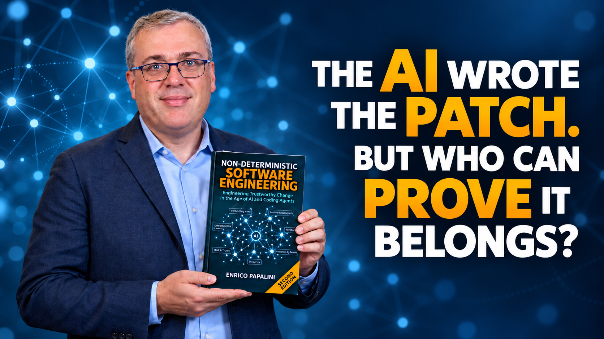
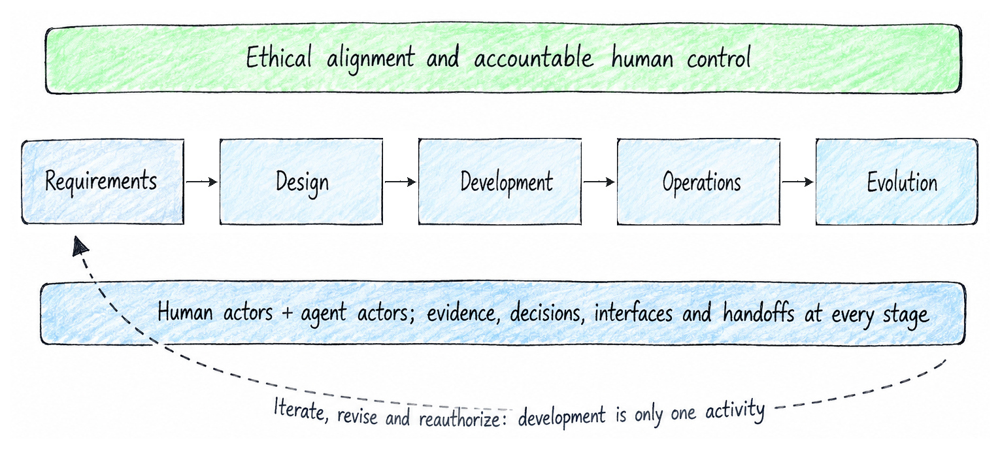
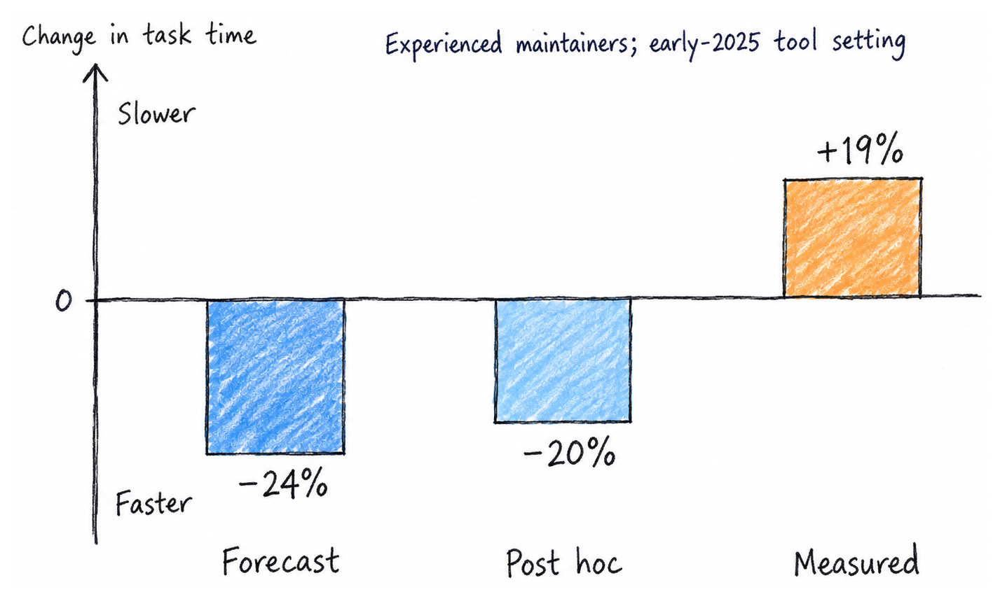
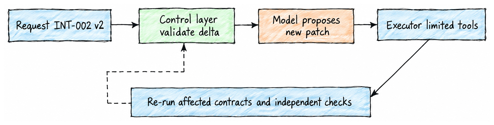
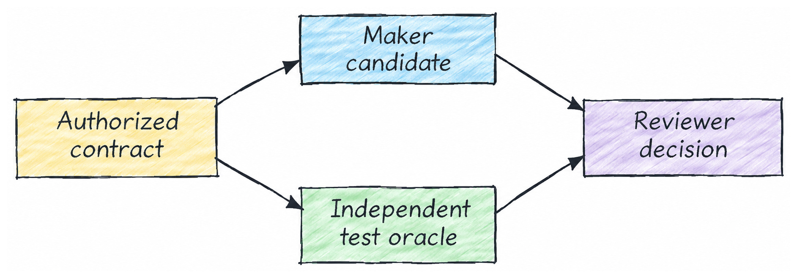
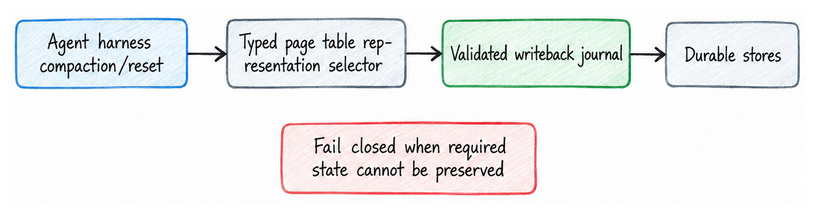
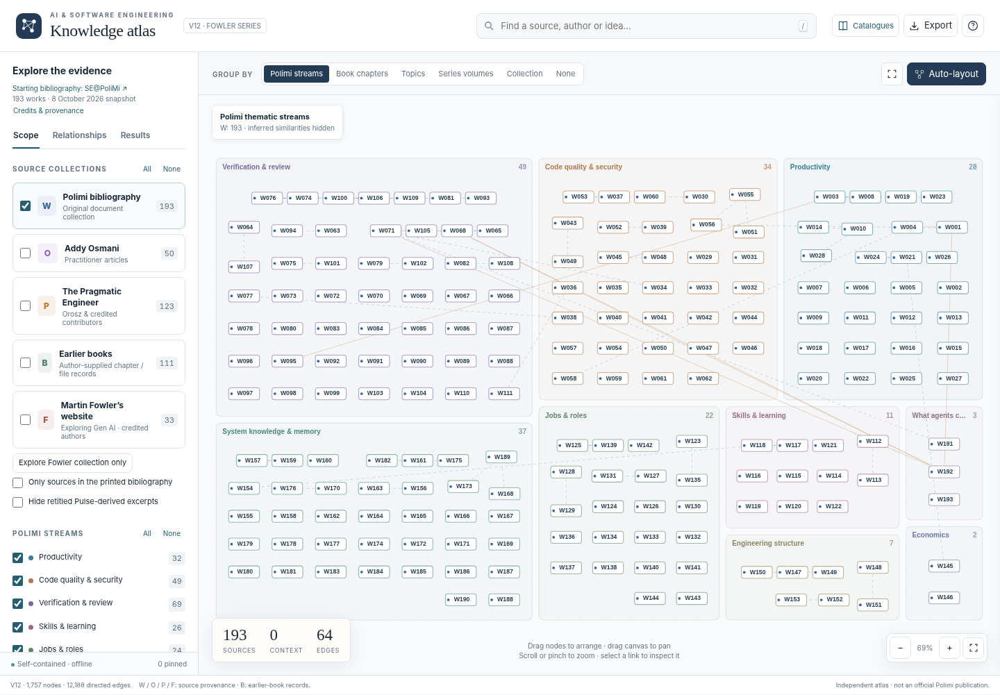
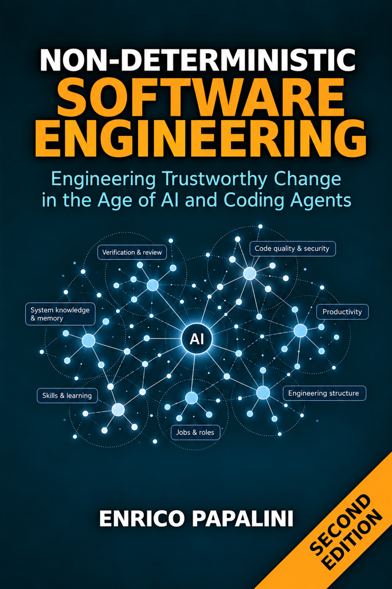

# The AI Wrote the Patch. But Who Can Prove It Belongs?

*Why Non-Deterministic Software Engineering needed a Second Edition — and what the research really tells us about coding agents, productivity, and trustworthy software.*

**By Enrico Papalini · October 2026**

Imagine a Monday morning maintenance request.

Your team needs to lower a departmental approval threshold from €5,000 to €3,000. An AI coding agent inspects the repository, finds the relevant configuration, updates the policy class, generates a few tests, and reports success.

The build is green. The patch looks clean. The whole operation took fifteen minutes.

Then a colleague asks a simple question:

**“What happens if yesterday’s €4,000 request is submitted again?”**

That is where the easy part ends.

A new €4,000 request should follow the new €3,000 threshold and require review. But a retry of yesterday’s request, using the same idempotency key, must preserve the decision recorded under the previous €5,000 policy.

Two apparently identical requests. Two different correct outcomes.

Changing one constant does not solve that problem. Neither does generating more tests if those tests simply repeat the agent’s mistaken interpretation.

Someone must establish the intended behavior, identify the authority behind the rule, preserve historical decisions, and demonstrate that the implementation respects those obligations.

This is a **synthetic** example from my new book. The service only recommends eligibility or review; it does not authorize payments or move funds. I deliberately chose something unremarkable. Because the most consequential difficulties in AI-assisted software engineering are often hidden inside ordinary maintenance work.

**The model can finish generating code long before the organization has finished engineering the change.**

That distinction became the central argument of the Second Edition of *Non-Deterministic Software Engineering*, which I am introducing today. And it fundamentally changed how I approached the book.

## The Question Has Changed Since 2025

When I published the first edition in December 2025, the industry was still learning how to incorporate probabilistic AI assistants into professional development.

The central question was how to benefit from AI-generated code without sacrificing quality, security, or human control.

That question remains important. But the tools, workflows, and research have evolved considerably.

In the following months, I explored Spec-Driven Development, enterprise governance, autonomous coding agents, and Loop Engineering in other volumes of the Non-Deterministic series.

Meanwhile, research on AI-assisted software development started producing something particularly interesting: apparently contradictory results.

Some experiments measured substantial productivity improvements. Others showed experienced developers slowing down. Coding benchmarks improved rapidly, yet questions about maintainability, human comprehension, and production readiness remained unresolved.

The temptation was to pick whichever result confirmed our expectations.

I became more interested in understanding **why these results differed**.

That led to a different starting point for the new edition:

> Stop measuring how much code AI produces. Start examining how much trustworthy, accepted, and maintainable change the entire engineering process delivers.

This is not a rejection of AI acceleration. It is an attempt to understand where that acceleration becomes real value — and where it merely transfers work to someone else.

*From the book: engineering work is a lifecycle that includes human actors, agents, evidence, decisions and handoffs.*

## The Productivity Paradox: How Can AI Make Developers Both Faster and Slower?

Consider three studies.

Cui and colleagues published [*The Effects of Generative AI on High-Skilled Work*](https://doi.org/10.1287/mnsc.2025.00535) in *Management Science*. The researchers examined three randomized field experiments involving 4,867 software developers. Across the combined experiments, access to an AI coding assistant was associated with a **26.08% increase in completed tasks**, with a reported standard error of 10.3 percentage points.

That is meaningful evidence that AI assistance can improve development output in certain professional settings.

Now consider a different result.

In July 2025, [METR published a randomized study](https://metr.org/blog/2025-07-10-early-2025-ai-experienced-os-dev-study/) involving 16 experienced open-source developers working on 246 tasks in repositories they knew well. Using the AI tools available during that study, developers took approximately **19% longer** to complete their tasks when AI assistance was permitted.

Even more interesting, the developers believed the tools had accelerated them.

A third experiment, involving [96 Google engineers](https://arxiv.org/abs/2410.12944), estimated approximately **21% less time** spent on a selected enterprise development task with AI assistance, although the confidence interval was wide.

So which result should we believe?

Potentially all three — **within their respective experimental boundaries**.

The studies observed different populations, tools, tasks, working environments, and outcomes. Completed tasks are not the same as elapsed task time. Neither is necessarily equivalent to production releases or long-term maintenance value.

And the results are time-dependent. METR itself [revisited the issue in February 2026](https://metr.org/blog/2026-02-24-uplift-update/), explaining that wider AI adoption and participant-selection effects made its newer productivity estimates difficult to interpret reliably. An early-2025 result should not become a permanent verdict on AI systems released later.

*From Chapter 2: forecast acceleration and retrospective perception can disagree with the measured task-time effect. These percentages come from a particular study, not a prediction for today’s models.*

This is the first important lesson of the new edition:

**A productivity percentage without its denominator, population, tool generation, and evaluation method is barely an engineering claim.**

Before adopting an AI tool, a team should decide what improvement it actually wants to observe. Faster initial implementation? Less developer effort? More accepted changes? Shorter delivery lead time? Fewer defects? Lower maintenance cost?

These are related goals, but they are not interchangeable.

## A Passing Benchmark Is Not a Merge Decision

There is another research result that makes this distinction particularly concrete.

In March 2026, METR published [*Many SWE-bench-Passing PRs Would Not Be Merged into Main*](https://metr.org/notes/2026-03-10-many-swe-bench-passing-prs-would-not-be-merged-into-main/).

The researchers asked active repository maintainers to review AI-generated changes associated with SWE-bench Verified tasks. The central observation was that automated benchmark success and maintainer acceptance could differ substantially. In their sample, maintainer acceptance was approximately **24 percentage points below** the automated grader result after the study’s normalization.

The research has important limitations. The maintainers reviewed historical patches without a normal feedback-and-revision cycle, and the sample covered only part of the benchmark. It does not prove that agents cannot produce mergeable code.

But it demonstrates why a benchmark result cannot be casually translated into a claim about real-world delivery.

A test suite answers questions about the behavior it checks. A maintainer may also need to evaluate integration, architectural consistency, repository conventions, future modification costs, or behaviors the automated tests never considered.

And even a mergeable patch is not automatically an operable production release.

**Generated does not mean verified. Verified does not mean accepted. Accepted does not automatically mean operationally successful.**

Each milestone introduces different responsibilities, costs, and possible failures.

## What Is the Real Unit of Software Engineering Work?

My answer in the new edition is an **accepted, operable change**.

Not a prompt. Not a generated function. Not a pull request. Not even an isolated green test suite.

An accepted, operable change is one whose intended behavior is understood, whose relevant evidence has been examined, whose acceptance has been authorized, and whose operational responsibilities can be fulfilled.

Return to the Treasury example. The agent should not begin by replacing €5,000 with €3,000. The team first needs to establish a versioned intention:

> **For a new €4,000 Treasury request under policy version 2**, the service must require review.
>
> **For a retry previously evaluated under policy version 1**, using the same idempotency key, the service must return the original recorded decision and policy version.
>
> The service must not silently reinterpret historical decisions using the current policy.

This is a much better input for an AI coding assistant. It defines both what should change and what must remain unchanged.

*From Chapter 4: a late change should update the authorized intention and the affected checks, not silently invalidate historical evidence.*

The next step is to construct **independent verification**.

That word — *independent* — is essential.

If the same model invents an interpretation, writes the implementation, and generates tests from that interpretation, the tests may faithfully confirm the wrong behavior.

A stronger approach protects the expected results outside the generator’s control, ideally using approved examples, historical records, contractual invariants, and separate verification responsibilities.

The implementation can then be checked against the authorized intention rather than its own explanation of correctness. Finally, the evidence must be associated with the exact version of the specification and the exact candidate being reviewed. Otherwise, yesterday’s green report may be attached to today’s different code.

*From Chapter 7: the maker produces the candidate; the independent oracle checks against an authorized contract; a reviewer decides what the evidence supports.*

This is where Spec-Driven Development, conventional engineering controls, and agent orchestration meet. The important object is no longer the generated patch alone. It is the **complete change and the evidence supporting its acceptance**.

## Three Costs That AI Acceleration Can Hide

Once code becomes inexpensive to generate, other parts of software engineering become more visible.

### 1. Review becomes the bottleneck

Imagine a team that can independently verify eight patches per week. An AI agent increases candidate production from ten to twenty. The team has doubled the number of proposed changes, but its verification capacity remains eight. The additional candidates accumulate in a queue.

This is a simple illustrative example, not a measured production result. Yet it exposes a fundamental systems problem: optimizing one activity does not necessarily improve the throughput of the entire process.

More generation may require better verification tooling, clearer acceptance criteria, or risk-based allocation of review effort. It may also require generating fewer, better-scoped candidates. The appropriate answer depends on where the actual constraint lies.

### 2. More context does not necessarily mean more understanding

AI agents increasingly depend on persistent memory, retrieval systems, repository instructions, and architectural summaries. These mechanisms can preserve valuable knowledge across sessions.

But memory introduces another failure mode: obsolete information can remain convincing long after it becomes incorrect.

Imagine an agent retrieving a beautifully written explanation of the old €5,000 policy. The document is relevant. Its wording is clear. Its reasoning is internally consistent. It is also no longer authoritative for new requests.

A useful engineering memory therefore needs more than a text summary. It needs provenance, ownership, applicable versions, and conditions under which the recorded knowledge must be reconsidered.

*From Chapter 9: persistent knowledge must carry provenance and validation; stale facts should not be silently promoted into authority.*

And there is a human dimension. If a developer routinely accepts generated solutions without reconstructing their rationale, who will understand the service six months later?

The risk is not that every use of AI reduces learning. AI can also explain, teach, and accelerate understanding. The question is whether the organization preserves the capacity to reason about its systems independently when necessary. That capability should be evaluated, not assumed.

### 3. Cheap generation can produce expensive delivery

The advertised cost of an AI-generated patch usually covers only a fraction of the engineering work.

The total cost may also include clarifying the request, investigating the existing system, supervising execution, reviewing the candidate, repairing failures, testing integration, handling deployment, and maintaining the result.

A model that produces an acceptable change on the first attempt may be economically attractive. A cheaper model that requires repeated corrections and extensive review may cost more overall.

But the reverse can also be true. A lightweight assistant or a straightforward deterministic tool may be sufficient for a narrow change, making elaborate orchestration unnecessary.

That is why the book examines **cost per accepted change** rather than simply cost per token or generated line. The appropriate economic decision must include failure rates, reviewer effort, rework, and operational consequences.

There is no reason to assume that more autonomy is always the better investment.

## A Practical Check Before Delegating Your Next Change

These ideas can be applied without adopting a new framework or buying another tool.

Before handing a meaningful change to an AI agent, I would ask six questions:

1. **What is the authorized intention?** Identify the behavior requested and the person or source entitled to define it.
2. **What must remain unchanged?** Preserve existing invariants, historical commitments, and system boundaries.
3. **What may the agent actually do?** Define its permissions, accessible tools, data, and stopping conditions.
4. **How will correctness be checked independently?** Use expected outcomes grounded outside the candidate implementation wherever possible.
5. **Who accepts the result?** Separate technical success from authorization to merge, release, or perform consequential actions.
6. **What will we measure afterward?** Record elapsed effort, reviewer time, rework, operational effects, and the cost of maintaining the change.

These are familiar software-engineering questions. AI has not made them obsolete. It has increased the importance of answering them explicitly before execution accelerates.

## Why I Built a Knowledge Atlas Instead of Just Adding More References

While preparing the Second Edition, I encountered another problem.

Reading a large body of research is difficult. Remembering how its findings relate to one another is harder.

The same study may be relevant to productivity, review, learning, and organizational change. Different publications may report on overlapping datasets. A practitioner article may suggest an engineering mechanism without experimentally validating it.

A conventional bibliography preserves the references, but makes these relationships difficult to explore. I wanted something more useful.

The result is the online [**Knowledge Atlas for AI and Software Engineering**](https://popoloni.github.io/), a companion to the book.

The Atlas begins with 193 research works from the *Software Engineering @ PoliMi* annotated bibliography, curated by Alfonso Fuggetta, Damian Andrew Tamburri, and Alessandro Margara.

It also maps practitioner material, including work by Addy Osmani, articles from *The Pragmatic Engineer*, and the multi-author *Exploring Generative AI* series hosted at Martin Fowler’s website.

The October 2026 graph snapshot contains **1,757 nodes and more than 12,000 typed relationships**. Those numbers require an important qualification: they are not 1,757 independently validated studies. Many nodes represent topics, chapters, claims, methodological notes, and previous book material.

The Atlas is an editorial navigation and provenance system, **not an automatic machine for proving scientific claims**.

*The Knowledge Atlas provides a searchable graph and conventional source catalogues. Screenshot from the October 2026 site snapshot.*

Its practical value lies in the questions it helps readers investigate.

Suppose you encounter the productivity results discussed earlier. You can find the field-experiment record **W003** and compare it with the experienced-maintainer study **W023**. Follow their relationships, inspect their summaries and limitations, and open the original publications.

You can explore by topic, book chapter, research stream, or source collection. You can also identify when apparently separate publications depend on the same underlying work. Counting the same observation twice does not make an argument twice as strong.

**A knowledge graph should help you ask better questions, not give weak evidence an appearance of certainty.** That principle applies equally to the AI systems we build.

## What Is Actually New in the Second Edition?

The new *Non-Deterministic Software Engineering* is not simply the first edition with updated model names.

It is a substantially reworked treatment of the engineering discipline. Across **thirteen chapters**, a recurring synthetic approval-routing service follows the entire lifecycle of a change: understanding the request, evaluating productivity claims, bounding agent authority, specifying behavior, implementing safely, reviewing evidence, preserving knowledge, coordinating teams, and assessing economic value.

Each chapter includes practical engineering examples and exercises. The appendices provide worked decision guidance and explain how to navigate the Knowledge Atlas.

The book also addresses questions that have become harder to ignore as agents grow more capable: security of agent runtimes, independent test oracles, post-merge maintenance, comprehension debt, delayed learning, accountable governance, and the economics of autonomous work.

Equally important, it distinguishes established results from proposed engineering practices.

The book does not claim that every catalogued paper has been independently replicated, that its synthetic examples constitute field validation, or that any one workflow guarantees a productivity gain.

The objective is to connect evidence, principles, and practical decisions without pretending the remaining uncertainty has disappeared.

*Non-Deterministic Software Engineering, Second Edition — Engineering Trustworthy Change in the Age of AI and Coding Agents. Available in English and Italian.*

**[Explore the Second Edition on Amazon](https://www.amazon.com/dp/B0HN9KQLNG)**

### Where It Fits in the Non-Deterministic Series

With this release, I have reorganized the six-volume series around a new starting trilogy:

**Book 1 — Non-Deterministic Software Engineering, Second Edition** establishes the evidence-informed engineering foundations.

**Book 2 — Non-Deterministic Spec-Driven Development, Enterprise Edition (Second Edition)** develops the specification, framework, and delivery practices.

**Book 3 — Non-Deterministic Loop Engineering** explores bounded agentic autonomy and the systems required to govern it.

The three original volumes — *Non-Deterministic Software Engineering*, *Non-Deterministic Spec-Driven Development*, and *Non-Deterministic Autonomous Coding Agents* — remain available as **legacy volumes**.

Legacy does not mean obsolete.

**No book supersedes another.** Each contributes its own material and perspective. The current trilogy offers a coherent entry point; the complete six-book collection offers a richer understanding of how the discipline has evolved.

**[Discover the Non-Deterministic series on Amazon](https://www.amazon.com/dp/B0HN9KQLNG)**

*The book and series links above currently use the same Amazon URL supplied for this article.*

## The Engineer Still Owns the Outcome

I began this journey with a simple concern: how can developers benefit from increasingly capable AI without losing control of the software they build?

The research, experiments, frameworks, and agentic workflows have made that question more interesting, not less.

Software engineering is not becoming irrelevant because models can write code. The production of candidate implementations is becoming less expensive. That changes where the difficult work concentrates.

Understanding existing systems. Defining intent. Resolving ambiguity. Designing independent verification. Protecting security boundaries. Preserving knowledge. Making accountable decisions.

These responsibilities are not new. But they are becoming the essential structure around increasingly autonomous tools.

Perhaps the most important lesson of the Second Edition is also the simplest:

> **The agent’s declaration that the task is complete is the beginning of the acceptance decision, not the end of engineering.**

If the code is generated in fifteen minutes, that is an opportunity worth exploring.

If the team cannot explain why the change is correct, who authorized it, or how the next engineer will maintain it, the job is not finished.

That is the engineering discipline I wanted to explore in the new book. And it is the conversation I hope the Second Edition will continue.

---

**Non-Deterministic Software Engineering — Second Edition**  
*Engineering Trustworthy Change in the Age of AI and Coding Agents*  
Enrico Papalini

**[Read about the book on Amazon](https://www.amazon.com/dp/B0HN9KQLNG)** · **[Explore the companion Knowledge Atlas](https://popoloni.github.io/)**

*Suggested Medium tags: Software Engineering · Artificial Intelligence · AI Agents · Software Development · Generative AI*
