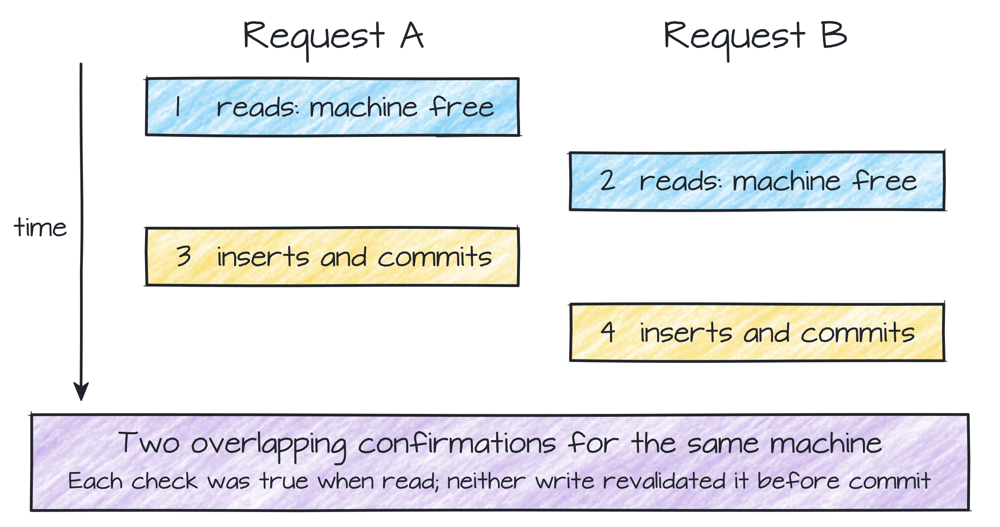
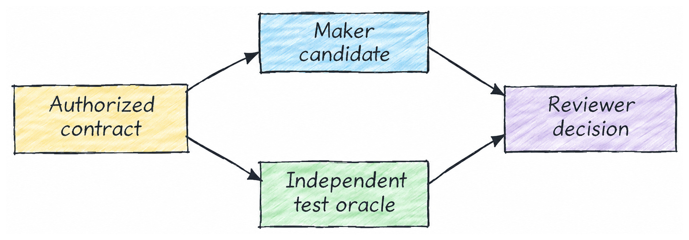
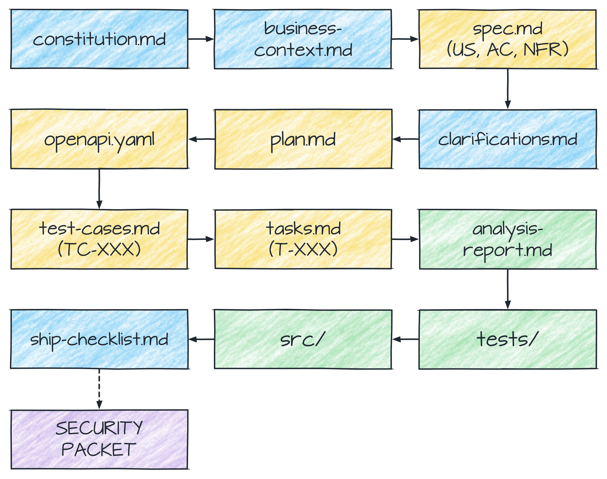

# The Agent Wrote the Fix. Would You Ship It?

How the engineer’s job changed in the year between *Non-Deterministic Software Engineering* and *Engineering Software with Agentic AI*

By Enrico Papalini

Two people turn up at a workshop at nine. Each has a confirmation for the same machine. You hand the bug to a coding agent. It comes back with a patch and a passing test. The workshop coordinator has one question for you. Can she trust tomorrow’s bookings?

About a year ago, when I wrote the first edition of *Non-Deterministic Software Engineering*, I was exploring a field whose boundaries were still hard to see. One boundary I could draw was at the keyboard. Say an assistant suggested removing an awkward branch from an import routine. The developer remembered that one customer still sent files in the old format. They could keep the branch, explain why it mattered, and finish the refactor by hand. I wanted the person who understood that history to stay in charge.

Writing *Non-Deterministic Spec-Driven Development* made me ask what would happen to that old file after the developer left the team. A sentence in the specification and a sample file could preserve what one person knew. By the time I wrote *Non-Deterministic Autonomous Coding Agents*, an agent could take a task all the way to a pull request while the developer was away. Leave the exception out of its instructions and, by morning, the patch and every test could agree on the wrong behavior.

Today, in *Engineering Software with Agentic AI*, the agent writes the entire booking fix. My job is to agree on the rule with the coordinator, limit what the agent can change, and devise an independent test that could prove the fix wrong. Then I decide whether to send it back or ship it.

In this teaching case, both requests see a free machine. Each issues a confirmation using an answer that can go stale before the write. Redrawn from *Engineering Software with Agentic AI*, fig. 5.2, p. 65.

With the publication of *Engineering Software with Agentic AI*, I’ve reshuffled the series. The second editions of *Non-Deterministic Software Engineering* and *Non-Deterministic Spec-Driven Development: Enterprise Edition* now lead into the new book. Here’s how I’d use the three together on that booking bug.

## Book one. Would you sign off on this test?

Suppose an agent submits a fix and a test. The test makes one reservation, waits for confirmation, and then tries to book the same machine again. The second request fails as expected. I’d keep that test. I’d also ask the author to show me what happens when the requests overlap. A team can spend a whole code review examining a perfectly good answer to the wrong question.

*Non-Deterministic Software Engineering*, Second Edition, follows an AI-assisted change through review and release. One of its most useful ideas is an independent test oracle. An oracle is simply how you decide what result to expect. If a test calls the same function as the implementation to calculate the right answer, a mistake in that function can make the two agree beautifully.

Follow the two arrows out of the authorized contract. One leads to the proposed implementation, the other to an independent way of judging it. From *Non-Deterministic Software Engineering*, Second Edition, fig. 7.3, p. 98.

That distinction also changes how I read a productivity claim. Saving an hour on the patch is worth knowing about. So is the afternoon a reviewer spends reconstructing a requirement, or the time a coordinator spends untangling two confirmations. The book’s companion Knowledge Atlas lets readers follow the research and practitioner sources behind questions like these. [Explore the Knowledge Atlas.](https://popoloni.github.io/)

## Book two. Can the next booking start at ten?

“Prevent double bookings” sounds clear until someone asks about the edges. If my booking ends at ten, can yours start at ten? Can two members use different machines at the same time? In the workshop example, the answer to both is yes. Those little examples do more work than a page of instructions telling an agent to be careful.

*Non-Deterministic Spec-Driven Development: Enterprise Edition*, Second Edition, compares public specification frameworks and shows how to carry a decision across a team. A workshop coordinator can settle the ten o’clock boundary. A developer can put the example in the specification. A reviewer can point back to it when a proposed fix accidentally prevents consecutive bookings. The requirement and its test stay linked even after the original conversation is gone.

An example from Enterprise Spec-Driven Development. You can trace a requirement through clarifications, an API contract and test cases to the release checklist. Redrawn from *Non-Deterministic Spec-Driven Development: Enterprise Edition*, Second Edition, fig. 12.4, p. 205.

In the book’s checkout example, a cross-check *removes* an implementation task. No requirement calls for it. The same review discovers an acceptance criterion with no test. One less thing to build, one more thing worth checking. That’s a good return on the time it takes to read a specification.

## Book three. What did the system actually do?

*Engineering Software with Agentic AI* gives you twelve chapters and eight practical missions in two systems. In the greenfield path, you build up the workshop service from its first persistent reservation. In the brownfield path, you inherit a Treasury router with decisions already on record. One Treasury mission asks you to preserve an earlier decision when the policy changes. The threshold falls from 5,000 to 3,000 euros. A fresh request for 4,000 euros now needs review. Replay yesterday’s request for the same amount with its original key, and you should get yesterday’s decision. As the engineer directing the agent, you choose what it may change and what evidence you’d keep to show a reviewer that both cases still work.

If you’re new to coding agents, start with the complete repair in Chapter 1. Every chapter follows the same cycle of *Expect, Delegate, Observe, Decide*. Agree on what success looks like, give the agent a bounded task, inspect what it actually does, and decide whether to continue or intervene. Try that last step with a recorded session. Cover the next entry, write the instruction you’d give, then uncover it and see what the operator chose. In a live mission, you give the instruction yourself. Each of the two routes on the map lets you carry your own changes through four missions. In the workshop, once you add cancellation, try replaying the original booking request. Can you retrieve the old confirmation and still show that the reservation is cancelled? Make your call before you turn to the worked answers at the back.

The first four parts follow a change from its initial request through release, recovery, and cost. In Part V, choose one of the two four-mission routes to put those decisions into practice. Adapted from *Engineering Software with Agentic AI*, “How to use this book,” fig. F.1, p. viii.

Back at the workshop, I’d ask the agent to implement one protected operation that checks availability and records the booking before confirming it. Then I’d run two competing requests against the same store. I’d inspect *both replies and the reservations left on disk*. One confirmation, one conflict, one surviving booking. A pair of reassuring messages alone would leave half the experiment undone.

If both callers get a confirmation, I stop the release. If the replies and the saved booking agree with the rule the coordinator approved, I can show her the evidence and explain why I’d ship. A year ago, I would also have written the fix with an assistant beside me. Today the agent can write it all. The signature on the release is still mine.

The new trilogy in reading order. An editorial guide to what each book contributes to the next engineering decision.

## Where the original three fit

The original trilogy now occupies positions four through six. Each still earns its place on my desk.

**4. Non-Deterministic Software Engineering, First Edition.** I reach for it when I want an assistant beside me to read unfamiliar code or guide a refactor with tests.

**5. Non-Deterministic Spec-Driven Development, First Edition.** This is the hands-on GitHub Spec Kit companion. Follow a feature from specification through planning and task breakdown into implementation.

**6. Non-Deterministic Autonomous Coding Agents.** Use it to design a coding loop that runs between human reviews. It covers failed tests, stalled retries, and when to hand work back.

Try the workshop problem with a colleague. Agree on the promise you want to make, let the agent write the fix, then run the two requests together. Would you put your name on the confirmation now? [Find the Non-Deterministic series on Amazon](https://www.amazon.com/dp/B0GHCXPBRM) or [try the workshop and Treasury missions on GitHub](https://github.com/popoloni/esa_ai).
