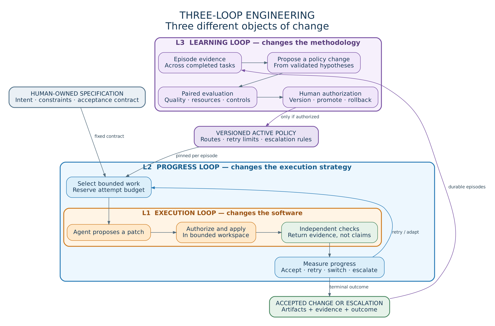
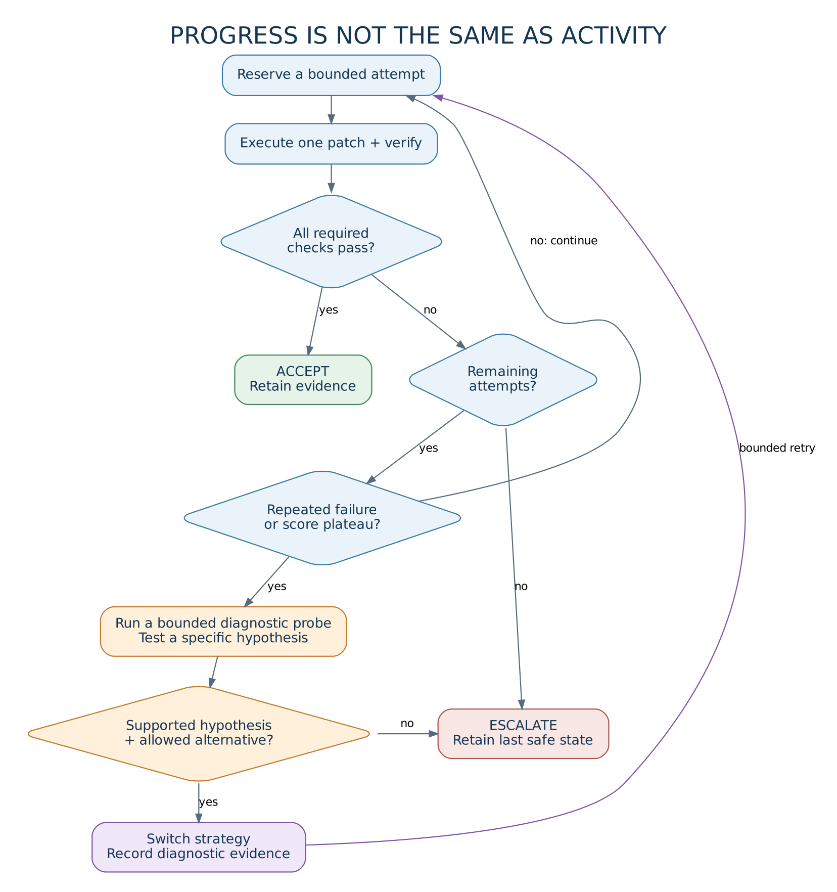
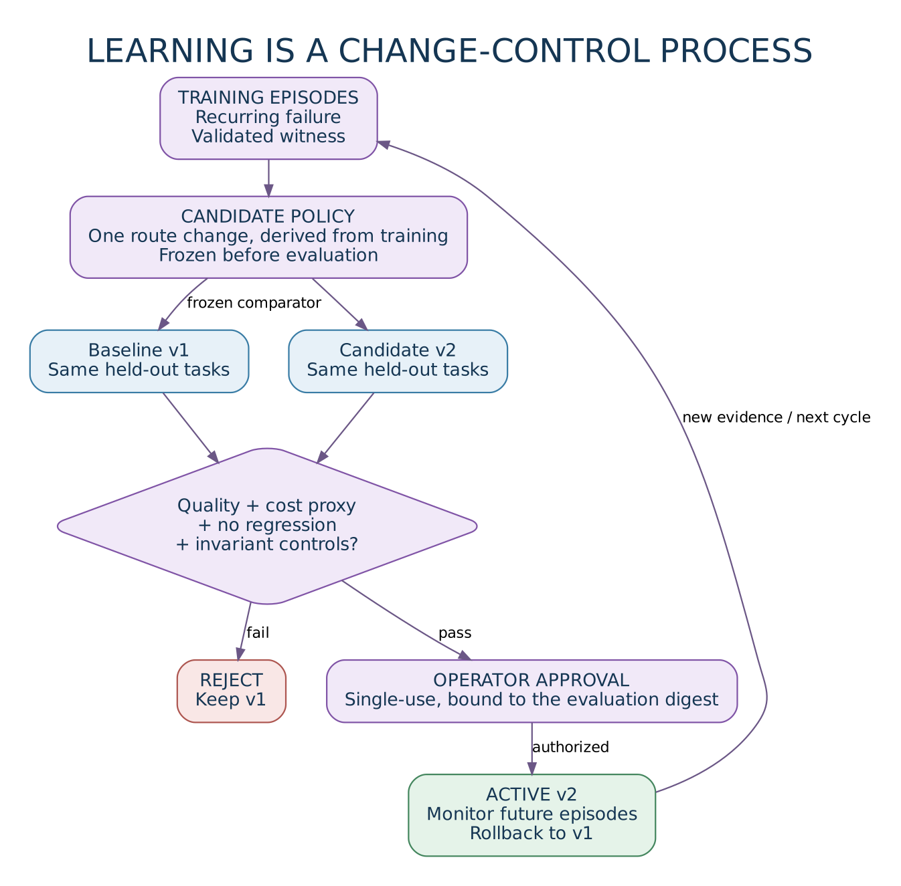
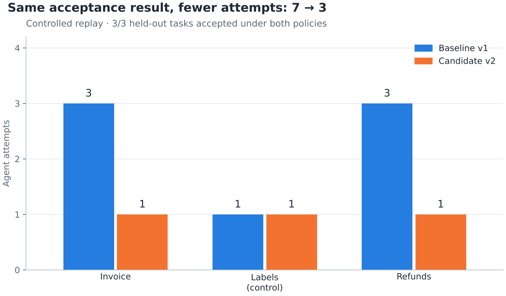

# Beyond the Loop: The Three-Loop Architecture for AI Agents

## How to engineer systems that execute, measure progress, and improve their own engineering methodology

**Enrico Papalini** · November 2026

Imagine going to sleep while an AI agent fixes your software. You wake up to a pull request, a green test suite, and a bill that makes you wonder whether you should have stayed awake.

The next night, the same agent encounters the same category of problem. It burns through the same reasoning steps, hits the same obstacle, and eventually finds the same solution. The code is different. The expensive journey is almost identical.

The system has delivered software. It has not learned how to deliver software.

This is where I believe the next important architectural shift in agentic engineering lies. We should stop thinking of an autonomous loop as a worker that tries until it succeeds. We should start thinking of a system that can improve the conditions under which its workers operate.

In my previous article, [Loop Engineering Is Spec-Driven Development in Motion](https://medium.com/%40enrico.papalini/loop-engineering-is-spec-driven-development-in-motion-695a57150f34), I argued that the engineer increasingly designs the conditions in which an agent reasons rather than personally steering each step. That article discussed specifications, persistent state, independent verification, budgets and escalation as the foundations of reliable autonomy.

A recent LinkedIn discussion with [Sam Iso](https://www.linkedin.com/in/sam-iso/) provided a useful extension. His illustrative folder structure separated a coding-loop template from a progress-loop template. We discussed the importance of detecting repeated failures before they consume the entire budget. The image suggested two distinct responsibilities; it did not establish how the underlying templates were implemented. That distinction led me to a question: what if the system could also improve the methodology that governs its future loops?

My proposal is a three-loop architecture. The first loop changes the software. The second changes the strategy by which the software is changed. The third changes the methodology by which strategies are selected and governed.

> The real objective is not to engineer agents that never fail, but to engineer systems that extract value from failure without endlessly paying for it.

## 1. The first loop: from prompting to execution

The simplest coding loop is almost embarrassingly small. Geoffrey Huntley popularized it as the [Ralph technique](https://ghuntley.com/ralph/): feed the same prompt to a coding agent, over and over. Here it is with a stop condition:

```bash
while not_done; do
    cat PROMPT.md | claude -p
done
```

`not_done` is left for you to implement, and nothing in this fragment establishes that the completion condition is trustworthy. The model call also conceals an entire runtime: context construction, reasoning, tool invocation, session state and possibly internal agentic loops.

The important distinction is not the number of shell statements. It is the authority assigned to each component.

An execution loop receives a bounded task, proposes a change, applies it within an authorized workspace and produces an artifact for verification. It should not be allowed to redefine the requirement, alter its own acceptance tests, silently increase the budget or decide that a plausible explanation is equivalent to a correct result.

The specification is the contract. The implementation agent is a worker. The acceptance mechanism is an independent source of evidence.

In practical systems, the executor may be Claude Code, Codex, a local model, or a specialized agent. The harness provides access to tools, isolation, context and runtime controls. Its internal loops may already be sophisticated. None of that eliminates the need to decide what evidence is sufficient, what actions are authorized, and what happens when an attempt fails.

I call the layer that changes the software **L1: the Execution Loop**. In the companion implementation, L1 exposes one bounded attempt; L2 drives repeated invocations. This makes the two responsibilities explicit instead of hiding an unbounded retry loop inside an ostensibly bounded call.

## 2. Three loops, three objects of change



*Figure 1 — The proposed architecture. The specification remains human-owned; learning produces a candidate policy, not an unrestricted ability to change the system.*

The architecture is not a stack of three language models. It is a hierarchy of feedback responsibilities, with potentially different frequencies, evidence requirements and authorities.

| Level | What it changes | Typical cadence | Evidence it needs | What it cannot authorize |
|---|---|---|---|---|
| L1 — Execution | A software artifact | One bounded attempt or tool sequence | Patch, build, tests, diff | Changing its own acceptance contract |
| L2 — Progress | The strategy for this task | Between attempts | Verification results, stagnation, diagnostic probes, remaining resources | Relaxing hard controls or granting new privileges |
| L3 — Learning | The reusable engineering methodology | Across episodes | Recurring patterns, validated hypotheses, paired evaluation, regression checks | Promoting its own policy or overriding human-owned constraints |

An episode is the complete lifecycle of one bounded task, from its initial specification and pinned policy to acceptance or escalation. L3 learns across episodes, not simply across the messages in one conversation.

This distinction is critical. Memory allows us to remember that an attempt failed. Progress control allows us to respond to the failure. Learning allows us to change how future tasks are handled, once there is evidence that the change is beneficial.

There is no requirement that the three levels use the same model, or that all three use models at all. The reference system deliberately keeps its controller and learning gate deterministic. Reasoning can be probabilistic; permission and acceptance do not need to be.

## 3. L2: Progress is not activity

The most primitive progress controller counts retries. It says: if the agent fails, try again, up to five times. This is a useful resource boundary, but it says almost nothing about whether a system is moving in the right direction.

Suppose four tests describe a task. The first attempt passes two. The second passes the same two and fails the same two with identical observed results. The third also passes two, but produces a different failure. Does that constitute progress? Not necessarily. It may represent new information, a regression, or noise.

A production progress controller needs a vector of observations rather than a single percentage. I would start with four dimensions:

- **Outcome progress:** are more required properties satisfied without regressing previously satisfied properties?
- **Evidence progress:** has an independently reproducible observation supported or falsified a useful hypothesis?
- **Resource consumption:** how much time, money, execution capacity and human attention have been spent, including the cost of verification?
- **Risk:** did the attempted change remain within its authorized scope and preserve the required invariants?

A single number may help rank actions; it must never override a hard acceptance or security condition. Passing more tests cannot compensate for violating a non-negotiable constraint. And a novel error is not automatically new knowledge.

In the reference system, outcome progress is the count of passing cases. A failure fingerprint is a hash of failed test identifiers and their observed results. Repeated identical fingerprints detect one specific form of stagnation; a plateau in the best observed score detects another. Both are deliberately modest heuristics. In larger repositories I would normalize unstable error text, distinguish infrastructure failures from product failures, and track per-property regressions as well as counts.



*Figure 2 — A repeated failure is a decision point. A supported diagnostic hypothesis can justify an authorized alternative; otherwise, the controller stops or escalates.*

The interesting decision is what happens at the circuit breaker. We do not need to choose only between continuing and abandoning the task. We can authorize a short, bounded diagnostic probe, ask whether its result supports a different strategy, and proceed only if a legitimate alternative and a remaining budget exist.

A probe is not an invitation to keep exploring indefinitely. It has its own defined scope. In the reference case there is one fixed, two-check diagnostic probe when a specific failure pattern is detected. The strategy can switch only once. No probe may rewrite the acceptance suite, enlarge the attempt budget or declare a failed change accepted.

An agent that disproves a hypothesis can create value even when it produces no shippable artifact. An agent that reports a hundred new errors has not necessarily created any value at all.

## 4. A real example: the half-cent that refuses to converge

I wanted a laboratory small enough that readers could audit every line, rather than a large agentic framework that obscures the architecture behind infrastructure. Consider a fictional financial application with several components that convert decimal amounts into integer cents. The explicit contract is: round a half-cent tie away from zero. For example:

| Input | Required integer cents |
|---|---:|
| `1.125` | 113 |
| `-1.125` | -113 |
| `2.01` | 201 |
| `0` | 0 |

A tempting implementation uses binary floating point and Python's `round`:

```python
def transform(value: str) -> int:
    return round(float(value) * 100)
```

This is wrong for the specified tie rule. `1.125` is exactly representable in binary, so `float("1.125") * 100` is exactly `112.5`, and Python's `round` sends exact ties to the even integer: `112`. The fixtures use such ties on purpose, so the failure comes from the rounding rule, not from representation error. Representation error is a second, separate trap: `1.005 * 100` evaluates to `100.49999999999999`, and one held-out amount, `123456789012345.01`, becomes a cent value above 2⁵³, beyond which a float cannot represent every integer.

A candidate that follows the contract uses decimal arithmetic:

```python
from decimal import Decimal, ROUND_HALF_UP, localcontext

def transform(value: str) -> int:
    with localcontext() as ctx:
        ctx.prec = max(28, len(value) + 4)
        return int((Decimal(value) * 100).quantize(
            Decimal("1"), rounding=ROUND_HALF_UP))
```

This is byte for byte the catalogue source the verifier executes. Raising the context precision keeps the multiplication exact for long inputs, which Python's default of 28 significant digits would otherwise round or reject. The contract deliberately covers ordinary finite decimal strings, not exponents, invalid inputs, currency-specific rounding or real payment processing: this is a teaching example, not financial production software.

The initial methodology, `v1`, intentionally prefers a cheap-looking but inappropriate float-based route. In scripted replay, the executor repeats the same patch twice. The L2 controller sees the same failure fingerprint twice and runs a trusted diagnostic probe on `1.125`. The probe shows that the float patch violates the contract on that input while a patch from the decimal route satisfies it, so the hypothesis is supported and the controller switches to the decimal route. The third attempt passes the full task suite.

The failure was useful. It provided a concrete witness: the original route does not satisfy the required tie behavior for this input. But it would be a mistake to ask the next component to discover this problem all over again.

## 5. L3: Memory is not learning

A common approach to agent memory is to append a sentence to a Markdown file: "Remember to use Decimal for money." This may be helpful, but it is an instruction, not an evaluated improvement to the engineering process. The system does not know whether the instruction will help future tasks, whether its scope is too broad, or whether another instruction will conflict with it.

My definition of operational learning is stricter:

> Operational learning is a durable, evidence-backed change to the policy governing future actions, evaluated against an independent contract before it is adopted.

The policy can choose a task route, select a diagnostic procedure, change the ordering of tools, insert a specialized verification stage or improve the conditions for escalation. It cannot silently rewrite the specification, remove a required test, increase its own permissions or promote itself to production.

The key is to treat policy changes like software changes. They have versions, authorship, a reason, evidence, a validation plan, a decision and a rollback path.



*Figure 3 — The methodology is a controlled artifact. Learning proposes; independent evaluation informs; authorized governance promotes.*

The reference implementation learns a deliberately narrow rule, and it reads only training episodes. If at least two distinct training tasks of one family were accepted after a supported diagnosis switched them to the same route, and no episode of that family contradicts it, the learner proposes making that route the family's default. The new route is read from the evidence rather than written into a pre-built candidate. Everything else stays as it was: the text-normalization route, all resource limits and all acceptance criteria.

The change is visible as a policy diff:

```diff
- "version": "v1",
- "money_start": "float_first",
+ "version": "v2",
+ "money_start": "decimal_exact",
  "text_start": "normalize",
  "max_attempts": 4,
  "repeat_limit": 2,
  "plateau_limit": 2
```

The learner is a deterministic rule in this lab, not an LLM. A more general system could use an LLM to propose hypotheses or policy diffs, but proposals would still need validation against a bounded schema and a separate gate. I would prefer to start with a small explicit policy language over an unrestricted self-modifying agent.

Crucially, the data used to propose a policy is not the same data used to judge it. The candidate is frozen after inspecting training episodes. Both policies run against the same held-out cases, including a text-normalization control where nothing should change. In this educational repository the fixtures are public and the developer knows them; the separation is in the program's data flow, not a claim of blind independent scientific evaluation.

## 6. From theory to source code

The companion repository is intentionally dependency-free for the runnable Python system (tested on Python 3.10 to 3.14). It contains the entire runnable experiment, acceptance fixtures, policy, retained evidence, negative tests, optional live adapter, and editable diagram sources. No API key is needed to reproduce the published numbers.

```text
three_loop_engineering/
  article.md
  README.md
  three_loop/
    agents.py          # scripted and optional Claude adapters
    execution.py       # L1: one bounded attempt
    verifier.py        # trusted acceptance and diagnostic controller
    worker.py          # separate verifier process
    progress.py        # L2: resource and strategy supervisor
    learning.py        # L3: candidate and evaluation gate
    audit.py           # hash-chained local trace
    model.py           # task, policy and evidence contracts
    catalog.py         # trusted patch candidates
    cli.py             # experiment, authorization, rollback
  specs/tasks.json
  policies/baseline.json
  tests/test_three_loop.py
  reproduce_results.sh
  figures/
  results/
```

The implementation is split along authority boundaries rather than along model providers. The executor applies only an allowed patch identifier; the verifier runs acceptance checks in a separate process over the actual source file; the supervisor reserves an attempt before calling the agent. This controlled lab executes only predefined catalogue code, not arbitrary LLM-generated code. A separate process is not an operating-system sandbox, and it would be unsafe to replace the trusted catalogue with unrestricted source generation without genuine isolation.

L2's core behavior is visible in the following excerpt from `progress.py` (simplified for the article):

```python
for n in range(1, policy.max_attempts + 1):
    # Reserve before the agent call, including failures.
    proposal, verdict = execute_attempt(...)
    if verdict.accepted:
        return ACCEPTED
    if repeated_failure or plateau:
        if authorized_probe_supports_alternative():
            route = alternative_route
            continue
        return ESCALATED
return ESCALATED
```

The real code also handles model and verifier errors, records every attempt with its evidence, checks patch scope and remaining budget, allows at most one strategy switch per episode, and writes an explicit stop reason.

The L3 gate is intentionally harder to satisfy than a vague claim of improvement. It checks that the only policy change is one route field plus the version; that the paired evaluation contains at least two target tasks and one control task; that every task is accepted under both policies; that no task needs more attempts; that the control's attempt count is unchanged; and that total attempts decrease. A local operator must then approve the digest of that exact evaluation before the active policy pointer changes. The approval is single-use: after a rollback, the same digest cannot re-promote the candidate. That takes a fresh evaluation.

The audit log hashes each record together with its predecessor. Source files, proposals, diagnostic reports and acceptance evidence are retained, and promotion revalidates the held-out reports and evidence hashes. A new episode refuses to start if the active policy pointer disagrees with the governance log. All of this exposes accidental or uncoordinated tampering; it is not an authenticated audit system, because a privileged local writer could rewrite the whole history.

## 7. What actually happened when I ran it

The first experiment uses a scripted executor, not a language model. It is an intentionally controlled replay: both methodologies use the same deterministic worker and identical acceptance suites. Only the default route is changed. That isolates the mechanics of the learning loop from model variability.

From the package root:

```bash
python -m unittest discover -s tests -v
python -m three_loop demo --out runs/experiment-01
```

The demo performs the training episodes, proposes `v2`, runs both policies on the three held-out tasks, and writes the evaluation report. The initially active policy remains `v1`. The actual replay produced these results:

| Held-out task | Baseline attempts | Candidate attempts | Baseline / candidate result |
|---|---:|---:|---|
| Invoice conversion | 3 | 1 | Accepted / Accepted |
| Text labels (control) | 1 | 1 | Accepted / Accepted |
| Refund conversion | 3 | 1 | Accepted / Accepted |
| **Total** | **7** | **3** | **3/3 accepted under each policy** |



*Figure 4 — Measured attempts, not estimated token consumption. The candidate maintained the same acceptance outcome on these three fixtures.*

The candidate requires four fewer executor invocations: approximately 57% fewer attempts in this small evaluation. The verifier tells the same story. The baseline started eleven verifier processes (seven acceptance checks, plus two diagnostic probes of two checks each); the candidate started three.

These numbers follow from the design. The scripted worker always tries the first patch of its route, so the outcome was predictable before the run. What the experiment tests is the machinery around it: that the diagnosis is recorded, that the candidate is derived from training evidence alone and frozen before evaluation, that the gate and the provenance checks pass, and that the negative tests (tampered evidence, a relaxed budget, a failed task, a reused approval, an unrecorded policy pointer) are rejected. It is not evidence that Claude is 57% cheaper, that arbitrary tasks converge faster, or that the methodology generalizes.

Learning was not free either. The paired evaluation alone consumed ten attempts to produce its evidence. At two attempts saved per subsequent money task, it pays for itself after about five such tasks, in this toy accounting and before counting human review. A real economic claim would need the full bill: training, evaluation, verification and governance.

To inspect and authorize the result, review `runs/experiment-01/evaluation.json` and the retained evidence first. Then use the `approval_digest` printed by the demo:

```bash
python -m three_loop promote --run runs/experiment-01 \
    --approve YOUR_EVALUATION_DIGEST
python -m three_loop run-active --run runs/experiment-01 \
    --task holdout_invoice --out runs/next-episode
```

A later episode now begins with the decimal route. The previous version remains available. To reverse the promotion, the operator supplies the original `baseline_sha`:

```bash
python -m three_loop rollback --run runs/experiment-01 \
    --approve YOUR_BASELINE_SHA
```

Replace the placeholders with the digests from your run; they are content bindings, not authentication tokens. The README has a copy-paste version.

The package also includes an optional live adapter for the Claude Messages API. The model receives the task contract, limited feedback and the pre-authorized candidates for the current route, and replies with a patch identifier. It has no shell, no file access and no authority over acceptance, so its choice is the only nondeterministic element. The adapter is tested against mocked responses, including a full mocked episode; no paid API run is part of the reported results. To try it, export an API key and choose a model available to your account:

```bash
python -m three_loop live --model YOUR_MODEL_ID \
    --task train_fees --max-calls 3 --max-output-tokens 256 \
    --out runs/live-01
```

The controller caps the number of calls and the output tokens requested per call, and records the token usage the API reports. That is not a monetary ceiling: input tokens and failed requests cost money too, so production spend limits belong outside the worker.

## 8. Is any of this actually new?

No single ingredient is new. Feedback control predates software agents by decades. Chris Argyris's discussion of [double-loop learning](https://hbr.org/1977/09/double-loop-learning-in-organizations) makes a distinction between correcting errors within existing assumptions and questioning the assumptions themselves. Autonomic computing, articulated by [Kephart and Chess in 2003](https://doi.org/10.1109/MC.2003.1160055), is another clear antecedent. Its MAPE-K family of architectures separates monitoring, analysis, planning, execution and shared knowledge. Continuous delivery and controlled experimentation offer mature practices for evaluating and promoting a change.

Recent writing on agent loops already nests them. Plaban Nayak's [four-loop design](https://levelup.gitconnected.com/loop-engineering-building-self-improving-ai-agents-with-four-nested-loops-c0f4a1437d4f), for example, ends with a hill-climbing loop that rewrites the agent's system prompt and keeps a change only if it beats the current best on the training split. That is a form of L3. The difference I am arguing for is where the authority sits: the candidate is judged on held-out tasks it was not derived from, next to a control; it can change only a bounded policy vocabulary; and a human promotes it, with a rollback path.

The three-loop model is a proposed synthesis for non-deterministic software engineering, not a claim to have invented feedback, learning or change control. The novelty I am interested in is the explicit allocation of authority around probabilistic reasoning: the software changes under a contract, the strategy adapts under a policy, and the policy evolves under a separate validation and authorization process.

A model upgrade may improve all three levels. But it is not a prerequisite for improving the system. The same model can become a more effective worker when the surrounding methodology becomes better. Conversely, a more capable model can still waste its budget in an incoherent loop.

## 9. Beyond the demonstration: making the architecture enterprise-ready

The reference implementation is a small, single-process controller with a separate verifier subprocess. Its learner can change exactly one kind of thing, a family's default route, and only one diagnostic exists to justify such a change, so in practice it learns the single transition from `v1` to `v2`. It is not an unattended production platform, and it does not learn arbitrary policies forever. Its value is that every boundary is inspectable and every claimed result can be reproduced.

A production architecture would add a number of capabilities. The most important are not new prompts; they are controls:

- An isolated and least-privileged execution runtime, with network restrictions, resource limits, separate workspaces, immutable acceptance suites and no production credentials in workers.
- A trusted evidence pipeline with signed artifacts, independently protected logs and independent verifier authorization; a separate process or a differently named subagent does not by itself establish organizational independence.
- A versioned specification and policy registry, durable event storage, idempotent state transitions, concurrency control, crash recovery and authenticated promotion or rollback.
- An evaluation portfolio with genuinely unseen tasks, adversarial tests, negative controls, repeated runs where nondeterminism matters, and protected holdouts that are refreshed after use. Optimizing against a known evaluation set is another form of overfitting.
- Full cost accounting: agent and verifier calls, input and output tokens, diagnostic experiments, compute, human review, maintenance and the value of avoided failures. A learning system must justify its own overhead.
- Shadow or canary promotion, monitoring by task family and risk class, a rollback trigger for observed regressions, and explicit policy ownership. Approval of one change must not become permission for arbitrary future changes.

These controls are consistent with the broader need to evaluate and manage generative AI risks, as discussed by [NIST's Generative AI Profile](https://doi.org/10.6028/NIST.AI.600-1). They are not a claim of compliance with that framework. Every organization's risk tolerance and regulatory obligations are different.

A genuinely adaptive learning loop also needs a stopping condition. When the next experiment is unlikely to create more value than it costs, further optimization should be deferred. A system that continuously rewrites its own methodology without demonstrating value has simply moved the original uncontrolled loop one level higher.

## 10. The unit of engineering changes again

When a developer moves from prompting to supervising an agent, the unit of work changes from a prompt to a loop. When a team moves from supervising loops to evaluating how those loops learn, the unit of engineering expands again: it becomes a governed methodology that can improve through experience.

The first loop produces a change. The second produces an evidence-backed decision. The third produces a better way of making decisions.

The three loops do not remove the human engineer from the architecture. They clarify where engineering judgment belongs. Humans own the objectives, the safety boundaries, the standards of proof and the authority to adopt a change to the process. Models and deterministic components contribute within that structure.

The most valuable artifact of an agentic engineering system may not always be the code it produces today. It may be the validated knowledge that prevents tomorrow's agents from paying to rediscover the same mistake.

**Don't just build loops that deliver software. Build loops that improve the way software is delivered.**

---

## Go deeper: *Loop Engineering for AI Agents*

The three loops stand on ground I cover in full in my book, [**Loop Engineering for AI Agents**](https://www.packtpub.com/en-it/product/loop-engineering-for-ai-agents-9781808766404), published by Packt. This article adds a third level of governance. The book is where the loops underneath it are designed, built, costed and chosen, one chapter at a time:

- **Foundations and critical assessment:** contracts that turn an objective into bounded, verifiable work, and governance templates for deciding when a loop deserves trust.
- **The organization becomes a loop:** who owns which decision once loops do the work.
- **The economics of loop engineering:** economic models and a worked case for the question this article could only sketch with attempt counts: when does autonomy pay for itself?
- **The Ralph loop:** the controller behind the one-line loop in section 1, taken seriously, with working listings.
- **Building a full local AI loop:** control policies and local models, assembled into a complete stack.
- **Choosing the right loop:** mechanisms matched to use cases, so you build the loop your problem needs rather than the one in fashion.

Every chapter has companion material (listings, templates and figures) in the book's [GitHub repository](https://github.com/popoloni/loopeng4aiagents).

If this article made you want to build loops rather than just read about them, start there.

**→ [Get *Loop Engineering for AI Agents* from Packt](https://www.packtpub.com/en-it/product/loop-engineering-for-ai-agents-9781808766404)**

### Run this article's companion

The complete companion is available in [the runnable companion guide](README.md). Run the offline experiment, inspect the evidence, try an invalid promotion and compare the active policies. The live adapter is optional. The package also includes the figure sources so you can adapt the architecture to your own stack. For the argument that led here, see my previous article, [Loop Engineering Is Spec-Driven Development in Motion](https://medium.com/%40enrico.papalini/loop-engineering-is-spec-driven-development-in-motion-695a57150f34).

### References

- Papalini, E. (2026). *Loop Engineering Is Spec-Driven Development in Motion.* [Medium](https://medium.com/%40enrico.papalini/loop-engineering-is-spec-driven-development-in-motion-695a57150f34).
- Papalini, E. *Loop Engineering for AI Agents.* Packt. [Book](https://www.packtpub.com/en-it/product/loop-engineering-for-ai-agents-9781808766404) · [Companion repository](https://github.com/popoloni/loopeng4aiagents).
- Huntley, G. (2025). *Ralph Wiggum as a "software engineer".* [ghuntley.com](https://ghuntley.com/ralph/).
- Nayak, P. *Loop Engineering: Building Self-Improving AI Agents with Four Nested Loops.* [Level Up Coding](https://levelup.gitconnected.com/loop-engineering-building-self-improving-ai-agents-with-four-nested-loops-c0f4a1437d4f).
- Argyris, C. (1977). *Double Loop Learning in Organizations.* [Harvard Business Review](https://hbr.org/1977/09/double-loop-learning-in-organizations).
- Kephart, J. O., & Chess, D. M. (2003). *The Vision of Autonomic Computing.* Computer, 36(1), 41–50. [DOI: 10.1109/MC.2003.1160055](https://doi.org/10.1109/MC.2003.1160055).
- IEEE Technology Navigator. [Autonomic Systems — MAPE-K control loop](https://technav.ieee.org/topic/autonomic-systems/).
- Autio, C., Schwartz, R., Dunietz, J., et al. (2024). *Artificial Intelligence Risk Management Framework: Generative Artificial Intelligence Profile.* NIST AI 600-1. [DOI: 10.6028/NIST.AI.600-1](https://doi.org/10.6028/NIST.AI.600-1).
- Anthropic. [Messages API reference](https://platform.claude.com/docs/en/api/messages/create) (for the optional adapter).
